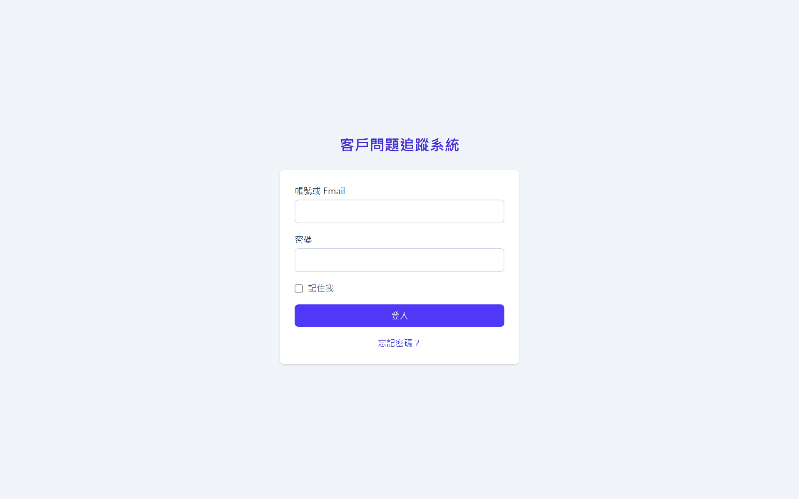
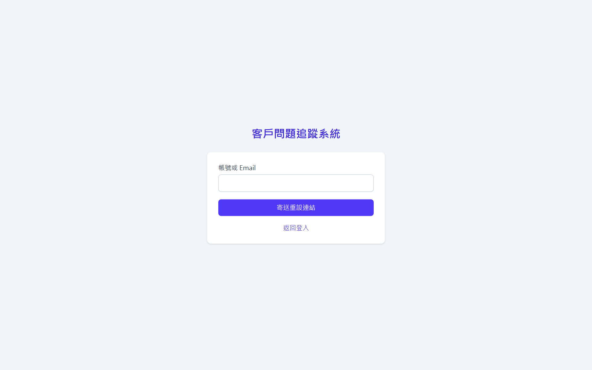
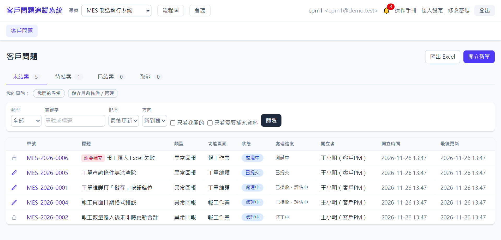
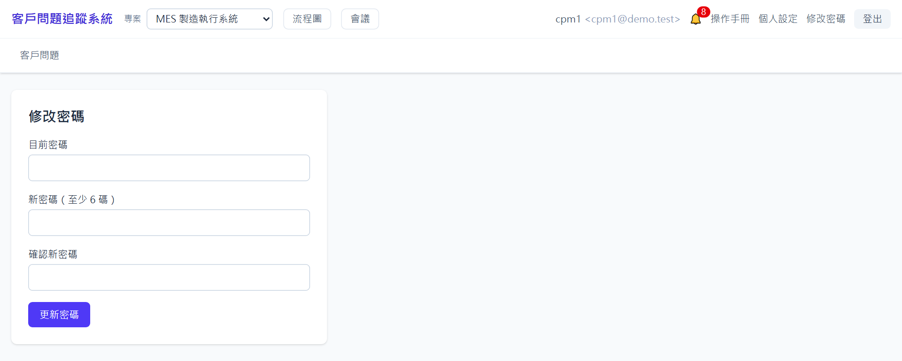
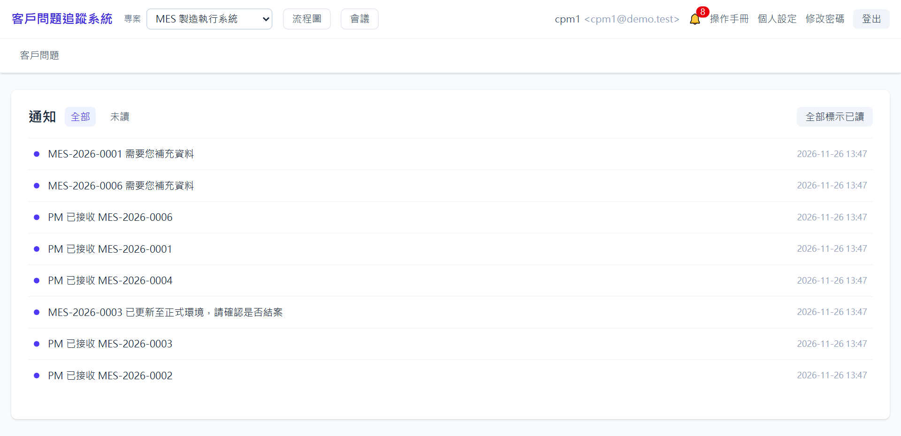
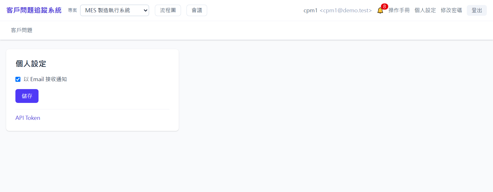

# 1. 開始使用

## 1.1 登入

1. 開啟系統網址。未登入時首頁就是登入畫面。
2. 輸入**帳號或 Email**，以及密碼。
3. 需要保持登入就勾「記住我」（公用電腦不要勾）。
4. 按「登入」並選定專案，進入「我的工作台」。從單據連結登入時會繼續開啟原頁面。

> 連續輸入錯誤 5 次會鎖定 15 分鐘（以「帳號 + 來源 IP」計算，次數與時間可由系統設定調整）。

## 1.2 忘記密碼

1. 登入畫面按「忘記密碼？」。
2. 輸入帳號或 Email，按「寄送重設連結」。
3. 到信箱點連結，**60 分鐘內**設定新密碼。

- 不論帳號是否存在，畫面訊息都一樣（避免帳號被探測）。
- 畫面顯示「系統未啟用郵件」時，請系統管理員直接重設密碼。

## 1.3 選擇專案

- 只屬於一個專案：登入後自動選定。
- 屬於多個專案：先出現專案選擇畫面；之後可用左上角「專案」下拉隨時切換。
- **角色與權限是依專案指派的**，切換專案後選單可能不同。

### 我的工作台

選定專案後，點「我的工作台」即可回到個人清單。頁籤數字是目前專案中符合條件的總筆數。點標題即可開啟對應的單據或會議事項。

| 頁籤 | 使用時機 |
|---|---|
| 我的待辦 | 查看自己擔任負責人的未完成會議事項，以及自己開立、等待補充或確認結案的客戶單。可操作的項目依專案權限顯示。 |
| 團隊待處理 | 查看目前角色可接手的共用工作。 |
| 我的排程 | 依日期查看有期限的會議事項。日期較早的排在前面，依台北日期標示「今天」與「已逾期」。 |
| 我的追蹤 | 在單據點「☆ 關注」後，可在這裡查看狀態與最近更新，包括已結案的單據。取消關注後就會移出。 |

「我的常用查詢」會顯示你在此專案儲存的查詢，點名稱就能帶入原清單的篩選條件。

<!-- internal -->
開發與測試的個人待辦依目前階段和承辦人判定。送測後移到測試人員名下，退回後回到開發人員名下。開始結案收尾後，只顯示尚待本人完成的收尾。排程另包含本人開發預計完工日、排程測試日，以及本人承測且有上線權限的預計上線日。

PM 可在團隊清單接收客戶單及審核展延；已接收且需處置、確認修訂或查看客戶補充的單據列入接收人的待辦。有上線權限的人員可在團隊清單找到待更新正式環境的單據，以及尚未指定個人的上線收尾。
<!-- /internal -->

## 1.4 畫面配置

| 位置 | 項目 | 說明 |
|---|---|---|
| 左上 | 專案下拉 | 切換目前專案 |
| 左上 | 流程圖 | 目前專案的流程文件 |
| 左上 | 會議 | 目前專案的[會議紀錄](11-meetings.md) |
| 右上 | 🔔 | 未讀通知數 |
| 右上 | 操作手冊 | 線上版本手冊（登入後可看，內容依帳號類型顯示） |
| 右上 | 個人設定 / 修改密碼 / 登出 | 帳號相關 |
| 第二列 | 功能選單 | 依角色顯示 |

<!-- internal -->
各角色看得到的選單：

| 選單 | 客戶 | 內部 PM / DEV / Test | 專案管理員 | 系統管理員 |
|---|---|---|---|---|
| 客戶問題 | ✔ | | | ✔ |
| 問題管理、開發管理、測試管理 | | ✔ | | ✔ |
| 時序總覽、報表、MES 頁面 | | ✔ | | ✔ |
| 流程圖 | ✔ | ✔ | ✔ | ✔ |
| 會議 | ✔ | ✔ | ✔ | ✔ |
| 專案管理 | | | ✔ | ✔ |
| 系統管理、郵件設定、匯出設定 | | | | ✔ |
<!-- /internal -->

## 1.5 修改密碼

輸入目前密碼、新密碼（兩次），按「更新密碼」。最短 6 碼。

> 第一次拿到管理員給的密碼後，請立刻修改。

## 1.6 通知與個人設定

- 點鈴鐺看通知；可切「全部 / 未讀」。
- 點一則通知會標示已讀並開啟相關單據；也可「全部標示已讀」。
- 自己做的操作不會通知自己。
- 單據的[關注者](07-common.md)會一起收到該單的通知。

### 客戶單通知

| 事件 | 通知對象（另加關注者） |
|---|---|
| 新客戶單 | 內部 PM |
| PM 接收 | 開單者 |
| 客戶修訂（接收後） | 接收的 PM |
| 客戶取消 | 接收的 PM |
| 客戶留言 | 內部 PM、相關處理人員 |
| 內部回覆、PM 處置 | 開單者 |
| 已更新正式環境，待您結案 | 開單者 |
| 客戶結案、提出異常 | 內部 PM |
| 要求補充資料 | 開單者 |
| 客戶已補充資料 | 提出要求的 PM |
| 超過 3 天未補充（只提醒一次） | 開單者、提出要求的 PM |
<!-- internal -->
| 連結的內部單全部取消／不處理 | 內部 PM 與內部關注者 |

### 內部單通知

| 事件 | 通知對象 |
|---|---|
| 建立時直接進入 DEV／Test 階段 | DEV、Test 負責人、關注者 |
| **階段**改變（PM／DEV／TEST／上線） | DEV、Test 負責人、關注者 |
| 內部留言 | 關注者 |
| 撤回送測（DEV 移出更新包） | DEV、Test 負責人、關注者 |
| 申請延期 | 有審核權限者 |
| 延期核准／駁回 | 申請人 |

同一階段內的狀態變更（例如「開發中」前後的調整）不發通知。
<!-- /internal -->

- 「以 Email 接收通知」：關閉後只剩站內通知。系統管理員未啟用郵件時，一律只有站內通知。

## 1.7 時間與單號

- 畫面時間一律為**台北時間**。
- 客戶單號：`前綴-年-流水號`（例：`MES-2026-0001`）。
<!-- internal -->
- 內部單號：`前綴-I年-流水號`（例：`MES-I2026-0001`）。
<!-- /internal -->
