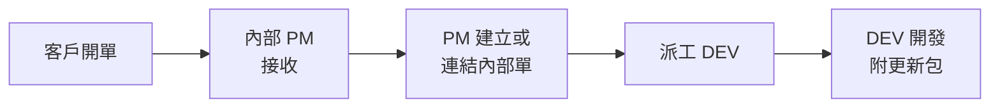
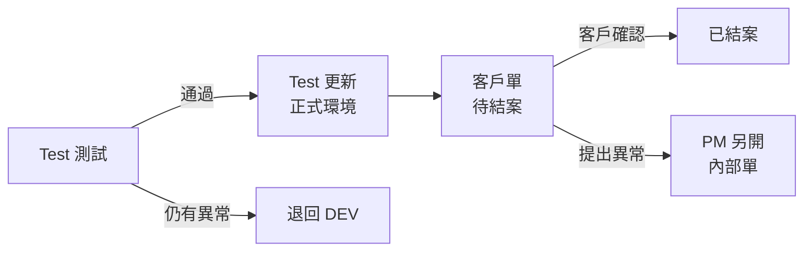
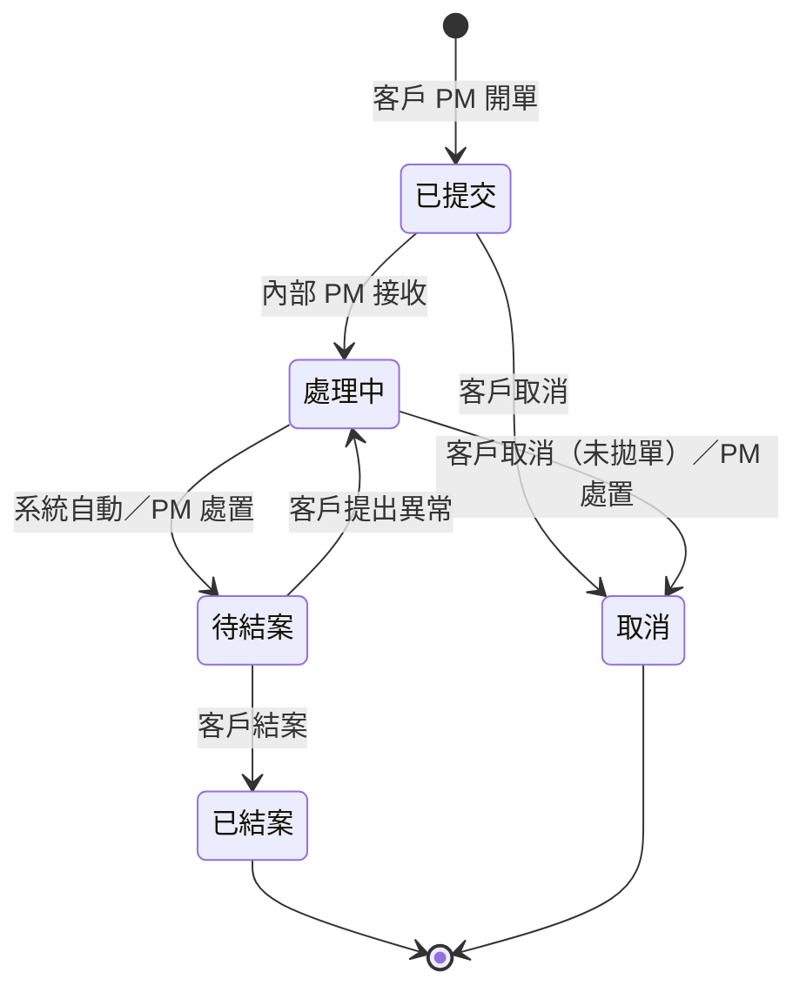
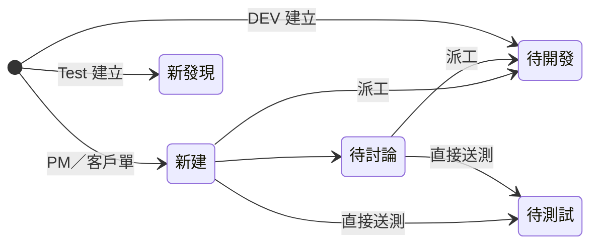
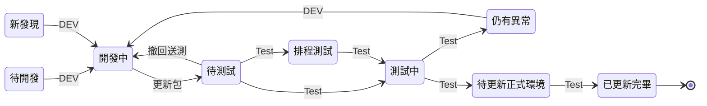
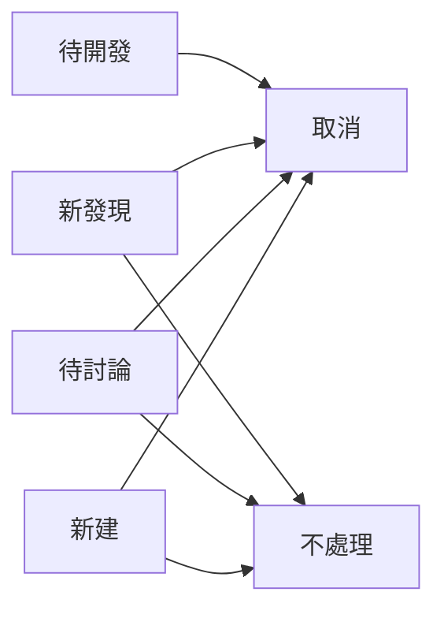
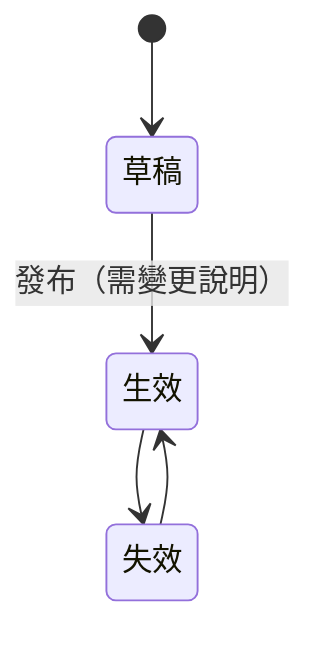

# 2. 流程與狀態

## 2.1 兩種單據

| 單據 | 誰看得到 | 用途 |
|---|---|---|
| 客戶單 | 客戶、內部人員 | 客戶回報異常或提出需求 |
<!-- internal -->
| 內部單 | 只有內部人員 | PM / DEV / Test 實際處理與追蹤 |
<!-- /internal -->

<!-- internal -->
兩者是**多對多**：多張客戶單可合併到一張內部單（同一個問題多人回報）；一張客戶單也可拆成多張內部單。
<!-- /internal -->

## 2.2 整體流程

受理到開發：

測試到結案：

## 2.3 客戶單狀態

| 狀態 | 客戶清單分頁 | 客戶 PM 可做 | 內部 PM 可做 |
|---|---|---|---|
| 已提交 | 未結案 | 編輯、取消、留言 | 接收、回覆 |
| 處理中（未拋單） | 未結案 | 提出修訂、取消、留言 | 建立／連結內部單、回覆、處置 |
| 處理中（已拋單） | 未結案 | 只能留言 | 建立／連結內部單、回覆、處置 |
| 待結案 | 待結案 | 結案、提出異常、留言 | 回覆 |
| 已結案 | 已結案 | 唯讀 | 唯讀 |
| 取消 | 取消 | 唯讀 | 唯讀 |

「處置」只在單據標示**需處置**時出現。

<!-- internal -->
## 2.4 內部單狀態

開單到派工（PM 階段）：

開發到上線（DEV／Test 階段）：

取消／不處理（僅內部 PM，需填原因）：

> 圖中「待更新正式環境」「已更新完畢」在系統上的全名是「測試通過待更新正式環境」「測試通過正式環境已更新完畢」。

## 2.5 各流轉的權責與必填欄位

| 從 | 到 | 誰 | 必填 |
|---|---|---|---|
| 新建 | 待討論 | 內部 PM | |
| 新建、待討論 | 待開發 | 內部 PM | DEV 負責人 |
| 新建、待討論 | 待測試 | 內部 PM | Test 負責人 |
| 待開發、新發現 | 開發中 | DEV | 預計完工日（已設定過就沿用） |
| 仍有異常 | 開發中 | DEV | |
| 開發中 | 待測試 | DEV | 更新包、Test 負責人（單上已有就沿用） |
| 待測試 | 開發中 | DEV（只能由「移出更新包」觸發） | |
| 待測試 | 排程測試 | Test | 排程測試日 |
| 待測試、排程測試 | 測試中 | Test | |
| 測試中 | 仍有異常 | Test | |
| 測試中 | 測試通過待更新正式環境 | Test | 預計更新日 |
| 測試通過待更新正式環境 | 已更新完畢 | Test | |
| 新建、待討論、待開發、新發現 | 取消 | 內部 PM | 原因 |
| 新建、待討論、新發現 | 不處理 | 內部 PM | 原因 |

取消／不處理時，若內部單有連結客戶單，**必須另外填「給客戶的說明」**。
<!-- /internal -->

## 2.6 自動規則

### 拋單鎖定

任一連結的內部單送到 DEV 或 Test 後，客戶單標示「已拋單」：

- 客戶不能再編輯、修訂、取消，只能補充留言。
- 此鎖定**永久有效**，即使內部單之後退回也不解除。
- 把客戶單連結到「已派工」的內部單，同樣立即鎖定。

### 自動轉待結案

取消／不處理的內部單不列入計算。其餘連結的內部單**全部**「已更新完畢」時，客戶單自動轉「待結案」並通知開單者。

### 需處置

出現下列情況時，客戶單標示「需處置」，等內部 PM 決定下一步：

| 情況 | PM 要做的事 |
|---|---|
| 剛接收，尚未建立內部單 | 建立或連結內部單 |
| 連結的內部單全部取消／不處理 | 轉待結案、取消客戶單，或開新內部單 |
| 客戶提出異常 | **開新的內部單**（原本已上線的單不動） |

### 要求補充資料

內部 PM 向客戶要資料時，單據標示「需要補充」，**狀態不變**，拋單鎖定與自動轉待結案照常運作。客戶留言或修訂內容後自動解除（見 [3.9](03-client.md)）。

<!-- internal -->
### 相依關係（需等待）

內部單設定「需等待」另一張單時，上游**未上線且未取消／不處理**之前，不能從 PM 階段派給 DEV（見 [4.13](04-pm.md)）。不影響客戶單自動轉待結案。
<!-- /internal -->

## 2.7 流程圖文件狀態

失效的流程圖僅供查閱，要先重新生效才能編輯。
