# 3. 客戶（客戶 PM / 客戶 View）

| 角色 | 能做的事 |
|---|---|
| 客戶 PM | 開單、編輯／修訂、取消、留言、結案、提出異常、關注、匯出、維護流程圖 |
| 客戶 View | 單據**唯讀**：看單、看流程圖、匯出；可關注單據、儲存自己的查詢 |

同一專案的客戶帳號**看得到彼此的單**。

## 3.1 客戶單清單

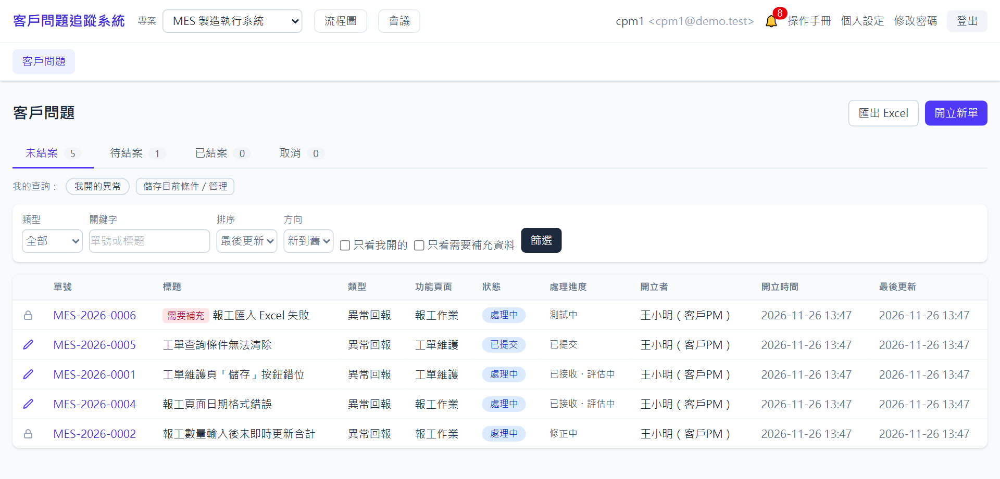

- 分頁：未結案／待結案／已結案／取消，數字為筆數。
- 篩選：類型、關鍵字（單號或標題）、排序、方向、「只看我開的」、「只看需要補充資料」。
- 「我的查詢」可把常用篩選存起來，見 [7.9](07-common.md)。
- 「處理進度」欄顯示目前做到哪一步；有排定上線日時顯示「預計 ○○ 更新」。
- 標題前的「需要補充」代表 PM 在等您提供資料，見本章 3.9。
- 「未結案」分頁左側圖示：✏️ 可直接編輯；🔒 無法編輯（滑鼠停上去看原因：已拋單、他人編輯中等）。
- 點整列開啟明細。
- 「匯出 Excel」依目前篩選條件匯出。

## 3.2 開立新單（客戶 PM）

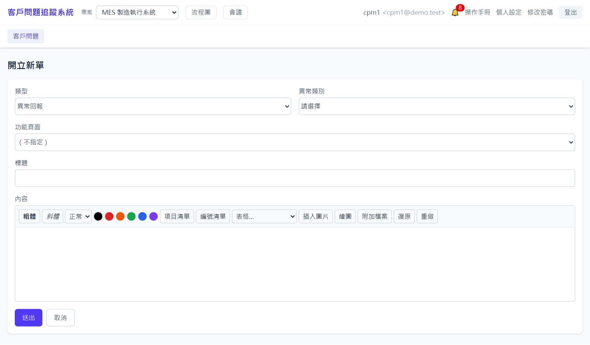

| 欄位 | 必填 | 說明 |
|---|---|---|
| 類型 | ✔ | 異常回報／新需求 |
| 異常類別 | 異常回報時必填 | UI 異常／功能異常 |
| 功能頁面 | | 選發生問題的 MES 頁面，可「不指定」 |
| 標題 | ✔ | 最多 200 字 |
| 內容 | ✔ | 支援圖片、表格、附件，見 [7.1 編輯器](07-common.md) |

按「送出」後取得單號，內部 PM 收到通知。

輸入標題時，若同專案已有相似的客戶單，下方會列出「可能是重複的問題」。點開確認是同一件事，就改在原單留言補充；不是則照常送出（提示不會擋單）。

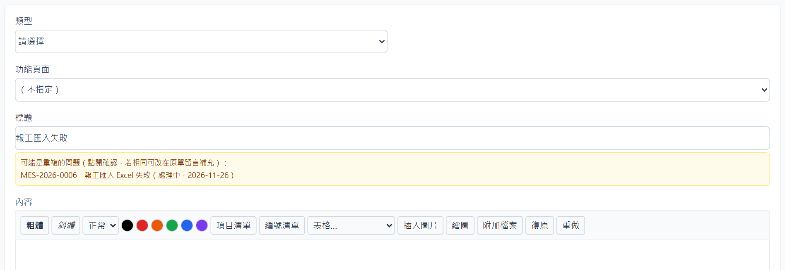

**寫單建議**：操作步驟 → 實際結果 → 預期結果 → 發生環境（瀏覽器、解析度）→ 截圖。

## 3.3 單據明細

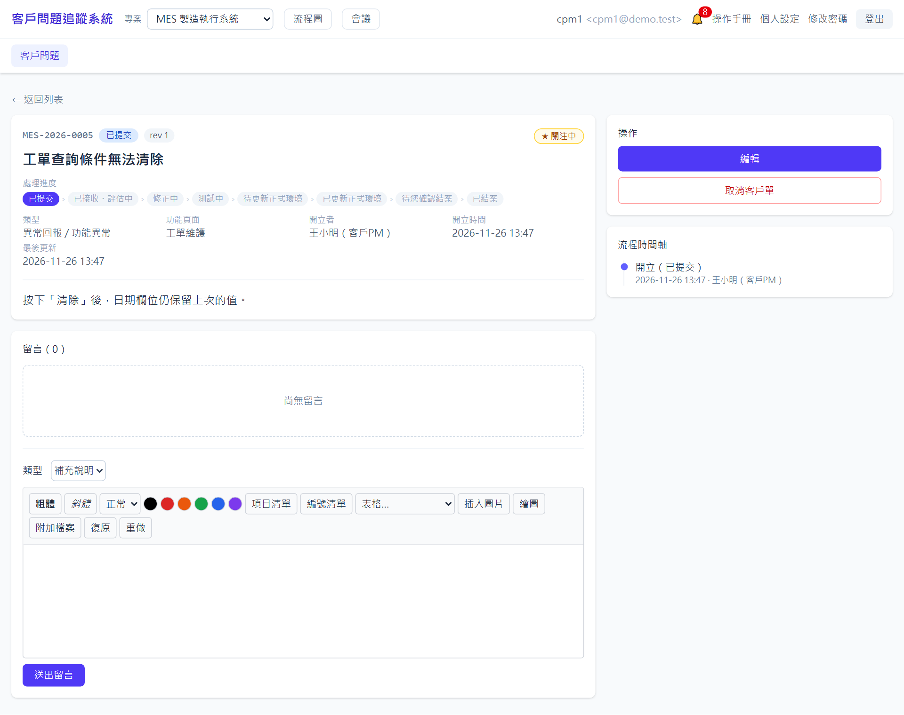

右側「操作」區只顯示目前可用的按鈕；「流程時間軸」記錄每一步由誰在何時處理。右上「☆ 關注」見 [7.8](07-common.md)。

### 處理進度

標題下方的步驟條顯示目前進度：

| 步驟 | 意義 |
|---|---|
| 已提交 | 等待 PM 接收 |
| 已接收・評估中 | PM 評估中，尚未派工 |
| 修正中 | 開發人員處理中（含測試退回重修） |
| 測試中 | 測試人員驗證中 |
| 待更新正式環境 | 測試通過，等待上線 |
| 已更新正式環境 | 該項修正已上線 |
| 待您確認結案 | 請依 3.7 驗證後結案 |
| 已結案 | 完成 |

- 一張單拆成多項處理時，以**進度最慢**的一項為準，所以進度可能往回退。
- 「預計 ○○ 更新正式環境」是尚未上線項目中最晚的排定日期，僅供參考。
- 取消的單不顯示進度。

## 3.4 編輯與修訂

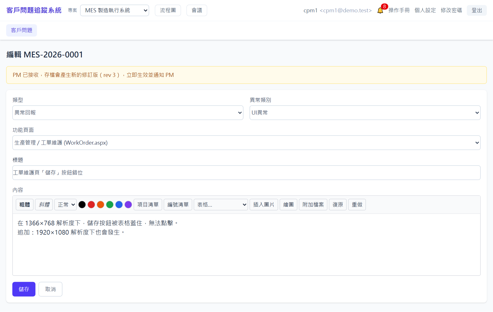

| 時機 | 按鈕 | 結果 |
|---|---|---|
| PM 接收前 | 編輯 | 直接更新 |
| PM 接收後、拋單前 | 提出修訂 | 產生新版本，**立即生效**並通知 PM |
| 拋單後 | （無） | 只能留言補充 |

- 進入編輯會取得**編輯鎖**：期間他人不能編輯，PM 也不能接收。內部派工會解除編輯鎖，尚未儲存的修改將無法存入（改用留言補充）。
- 編輯頁開著時系統每分鐘自動續鎖；離開請按「取消」或「儲存」，鎖會立即釋放。
- 出現「編輯鎖已失效」：按取消後重新進入（草稿可還原）。

### 修訂紀錄與比對

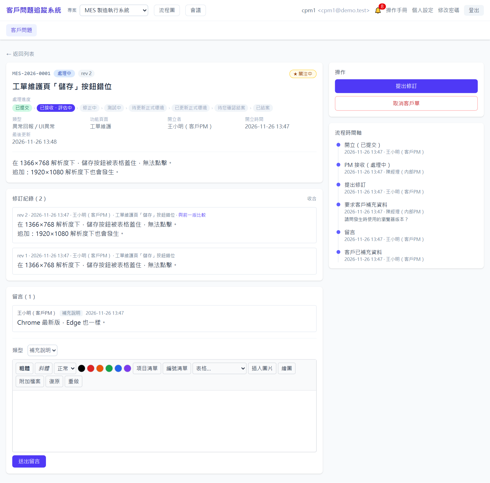

有兩版以上時出現「修訂紀錄」，按展開；「與前一版比較」顯示逐行差異。

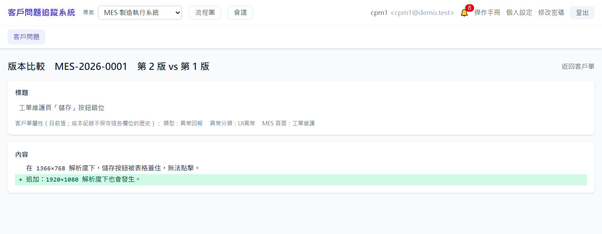

> 版本紀錄只保存標題與內容；類型、類別、功能頁面顯示的是目前值。

## 3.5 補充留言

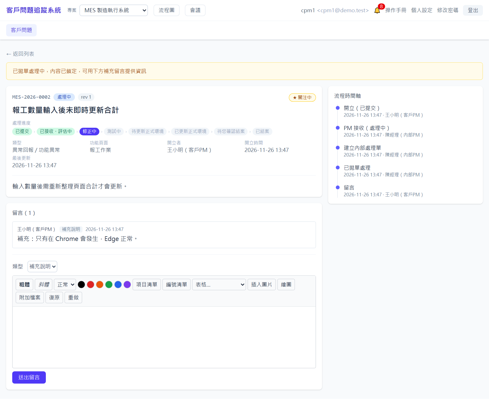

1. 明細頁最下方選留言類型（補充說明／詢問）。
2. 輸入內容，按「送出留言」。

- 留言送出後**不能修改或刪除**。
- 「已讀」列出看過該則留言的客戶帳號。
- 結案或取消後不能留言。
- PM 正在等您補充資料時，送出留言即視為回覆。

## 3.6 取消客戶單

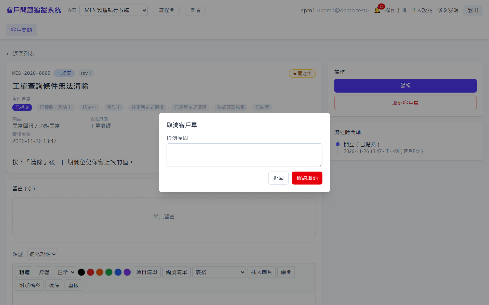

僅限拋單前。按「取消客戶單」→ 填原因 →「確認取消」。取消後**無法復原**，要重提請開新單。

## 3.7 結案與提出異常

單據變「待結案」代表修改已更新到正式環境，請實際驗證。

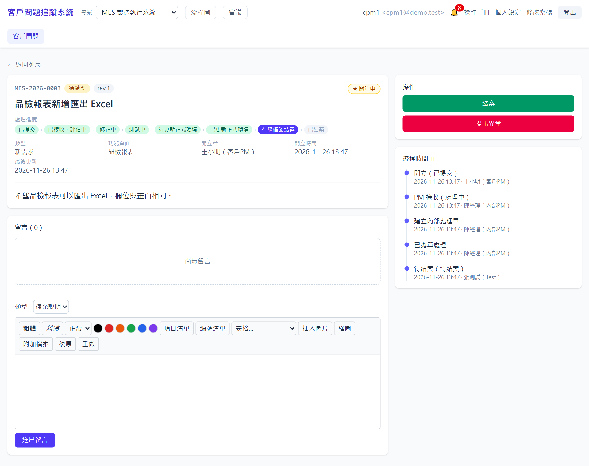

| 驗證結果 | 操作 |
|---|---|
| 正常 | 按「結案」→ 確認 |
| 仍有問題 | 按「提出異常」→ 描述現象 → 送出 |

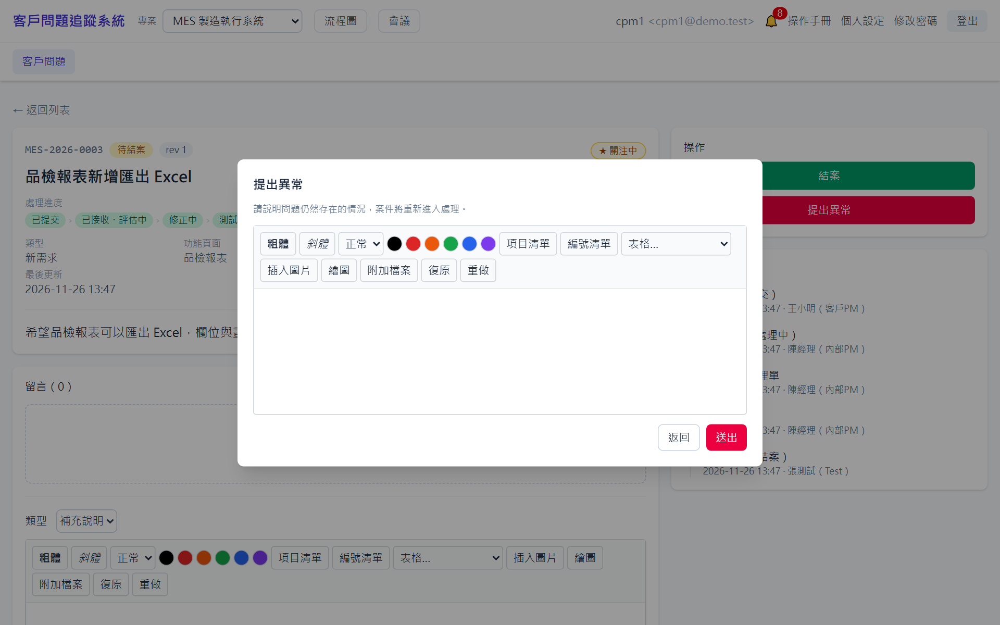

提出異常後單據回到「處理中」，PM 會另開內部單處理；每次提出都保留在「異常提出紀錄」。**結案後就不能再提出異常**。

## 3.8 客戶 View

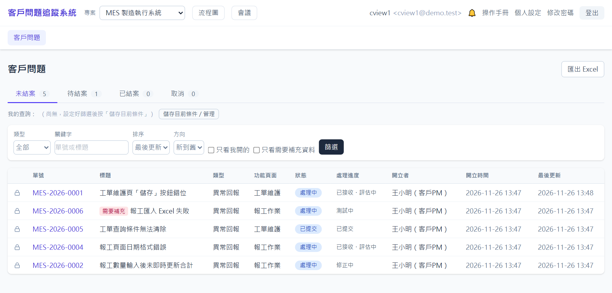

沒有「開立新單」，也不能編輯、留言、取消或結案。可以做的是查看、匯出、「☆ 關注」單據，以及儲存自己的查詢。需要提出問題請找客戶 PM。

## 3.9 PM 要求補充資料時

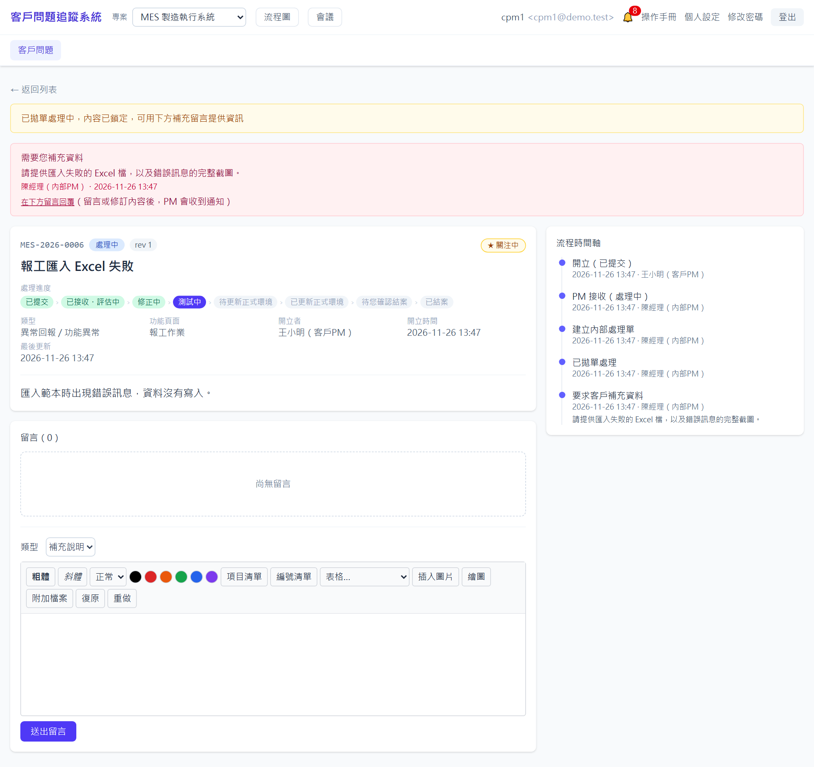

PM 需要您提供截圖、檔案或重現步驟時：

1. 您會收到通知，清單上該單標示「需要補充」（可勾「只看需要補充資料」篩出）。
2. 開啟單據，上方紅色框是 PM 需要的內容。
3. 按「在下方留言回覆」，附上資料後「送出留言」；尚未拋單的單也可以用「提出修訂」。
4. 送出後提示自動消失，PM 收到通知。

- 單據狀態不會改變。
- 超過 3 天未回覆，系統會提醒一次。
- 客戶 View 不能回覆，請轉給客戶 PM。
