# 4. 內部 PM

## 4.1 每日工作順序

1. **問題管理**首頁看五個計數：待接收、需處置、修訂未確認、等待客戶補充、客戶已補充。
2. 審核「待審核的延期申請」。
3. 到「時序總覽」看逾期與即將到期。

## 4.2 問題管理首頁

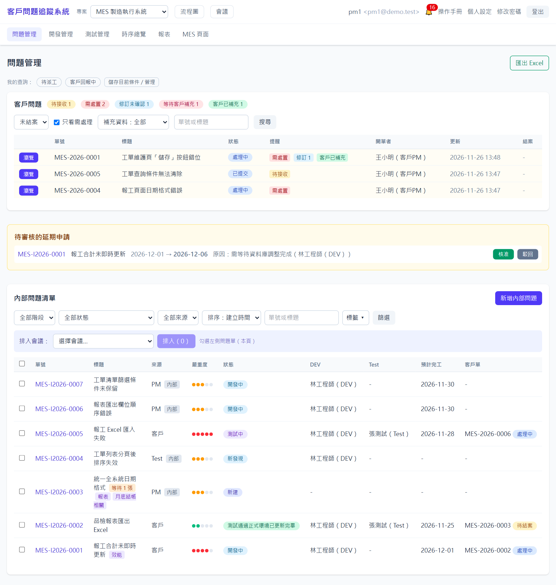

| 區塊 | 內容 |
|---|---|
| 客戶問題 | 範圍下拉：未結案（預設）／待結案／已結案／取消／全部；「只看需處理」**只在「未結案」有效**；可依補充資料狀態與關鍵字篩選。按「瀏覽」進處理頁 |
| 待審核的延期申請 | 有申請時才出現，直接按「核准」或「駁回」 |
| 內部問題清單 | 依階段、狀態、來源、關鍵字、標籤（勾多個＝符合任一）篩選；可依建立時間、最後更新、嚴重度、預計完工排序 |
| 結案收尾 | 每張內部單每輪各一列，預設顯示待收尾，先送出的排在前面。可切換狀態、搜尋單號或標題，或勾「只看我待確認」。點單號可進入收尾明細 |

- 「開單時間」是內部單建立時間。DEV 下方顯示 PM 首次派往待開發的時間；Test 下方顯示最近一次派測時間及來源（PM 或開發）。時間採台北時間，缺少派工紀錄顯示「—」。
- 「結案收尾」保留每輪送出結案當時的派工時間與來源。撤回後重新派工，可切到「全部」比較兩輪；直接結案且沒有收尾任務的單仍可在「內部問題清單」查詢。
- 點「等待客戶補充」「客戶已補充」計數可直接篩出。「客戶已補充」在 PM 開啟該單後消失。
- 客戶單清單的「結案」欄顯示客戶結案時間；客戶按結案時 PM 會收到通知，要查已結案的單把範圍切到「已結案」。
- 內部單標題後的「等待 N 張」代表有尚未完成的上游單（見 4.13）；紫色字是標籤。
- 「客戶單」欄同時顯示連結客戶單的狀態。
- 左側勾選框用於批次[排入會議](11-meetings.md)。
- 「我的查詢」見 [7.9](07-common.md)。

「匯出 Excel」保留目前篩選的客戶單與明細，另匯出所選頁籤的所有符合資料。「內部問題清單」附內部單明細；「結案收尾」依輪次列出進度、待確認人員及連往收尾明細的單號。

> 從通知、時序總覽或這一頁點客戶單，內部人員都會開到 PM 的客戶單頁面（有接收、回覆、派工按鈕）。

## 4.3 接收客戶單

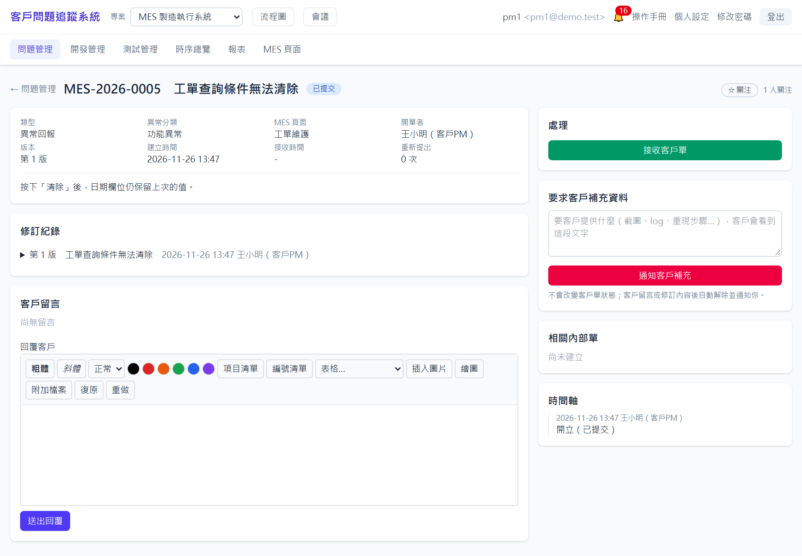

按「接收客戶單」。接收後：

- 狀態變「處理中」，並標示「需處置」。
- 客戶之後的修改變成「修訂」，會通知你。
- 出現「客戶 ○○ 正在編輯中」時暫時無法接收，請稍後重整。

## 4.4 建立／連結內部單

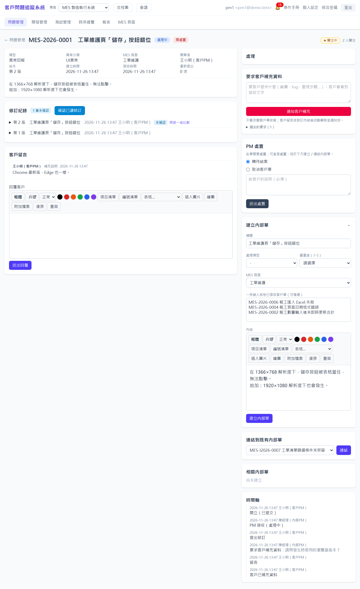

### 建立新內部單

1. 展開右側「建立內部單」。
2. 確認標題與內容（預設帶入客戶內容，可改寫成技術描述）。
3. **嚴重度（1–5，必填）**、處理類型、MES 頁面。
4. 同一問題有多張客戶單時，在「一併納入其他已接收客戶單」複選（按住 Ctrl）。
5. 按「建立內部單」。新單狀態為「新建」，尚未派工。

標題欄會提示相似的內部單與客戶單（見 [7.10](07-common.md)）；已有同一問題的內部單時，改用下方「連結到既有內部單」。

### 連結到既有內部單

「連結到既有內部單」選單據 → 按「連結」。若該內部單已派工，客戶單立即鎖定。

> 連結沒有解除功能，送出前請確認單號。

## 4.5 修訂確認

「修訂紀錄」顯示未確認版本。看過「與前一版比較」後按「確認已讀修訂」。修訂**不需核准**就已生效；若影響已派工的內容，請在內部單加「補充說明」。

## 4.6 回覆客戶與引用留言

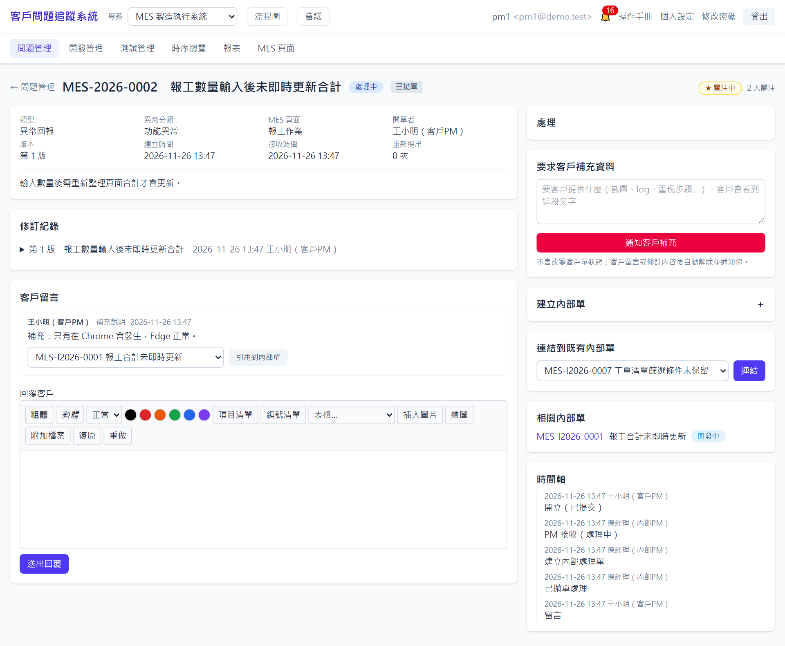

- 「回覆客戶」：客戶看得到，送出後不能修改。
- 客戶留言下方「引用到內部單」：把內容複製到指定內部單的補充說明，讓 DEV／Test 看到。

## 4.7 PM 處置

單據標示「需處置」時：

| 選項 | 用途 |
|---|---|
| 轉待結案 | 不需開發（例如操作問題），請客戶確認後結案 |
| 取消客戶單 | 不受理 |
| 建立／連結內部單 | 需要處理 |

前兩項的「給客戶的說明」**必填**，會顯示給客戶。

## 4.8 新增內部問題

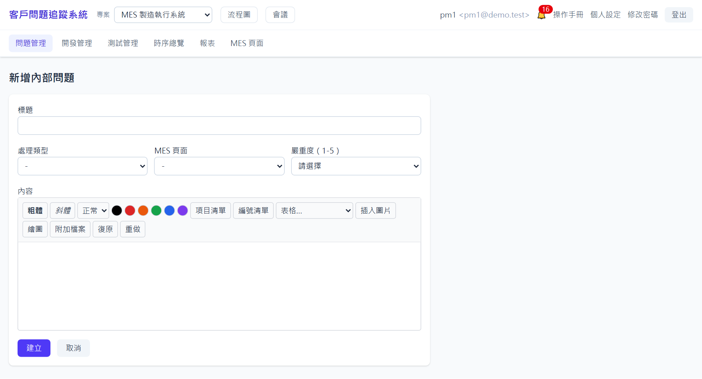

與客戶無關的改善項目：問題管理 →「新增內部問題」。標題、嚴重度、內容必填。客戶看不到。

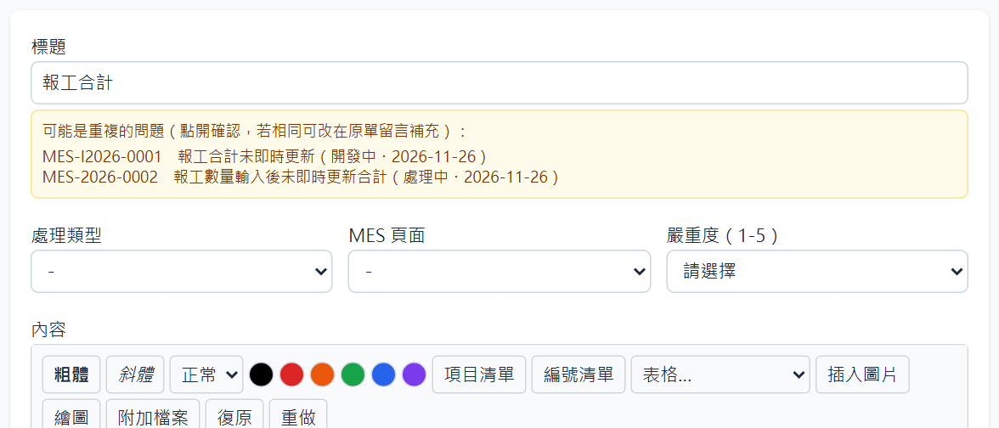

### Excel 匯入

一次建立多張內部單：問題管理 →「Excel 匯入」。只接受系統的標準範本。

1. 按「下載標準範本」。範本的下拉選項（處理類型、狀態、嚴重度、MES 頁面）是下載當下的設定，選項有變動時請重新下載。
2. 在「問題清單」一列填一個問題；序號、功能名稱、標題、問題內容、狀態必填（紅字表頭）。有截圖時另開一張工作表貼圖，並在「明細表」欄插入超連結指向它。截圖上的紅框、箭頭、文字方塊會合成成一張圖片。
3. 填來源代碼、選檔案，按「上傳並預覽」。預覽不會寫入任何資料。

| 預覽結果 | 說明 |
|---|---|
| 新建 | 預設勾選，可改處理類型、MES 頁面 |
| 內容有變更 | 這列以前匯入過，內容改了；勾選後寫成該單的補充說明 |
| 已匯入 | 同來源代碼 + 序號已建立過，不會重複建立 |
| 略過 | 狀態為結案、不處理 |
| 錯誤 | 缺必填欄位、序號重複等，修正 Excel 後重新上傳 |

4. 按「確認匯入」。勾選的列一次建立（任一列失敗就全部不建立），狀態都是「新建」。

同一份持續更新的紀錄請一直用同一個來源代碼；換了代碼，系統就認不出哪些列已經匯入過。匯入錯的單在「新建」狀態時可以刪除（見 4.9「刪除」）。刪掉的單還在回收筒時，那一列預覽會顯示錯誤；專案管理員永久刪除後，才能重新匯入。

## 4.9 內部單：派工、修改、取消

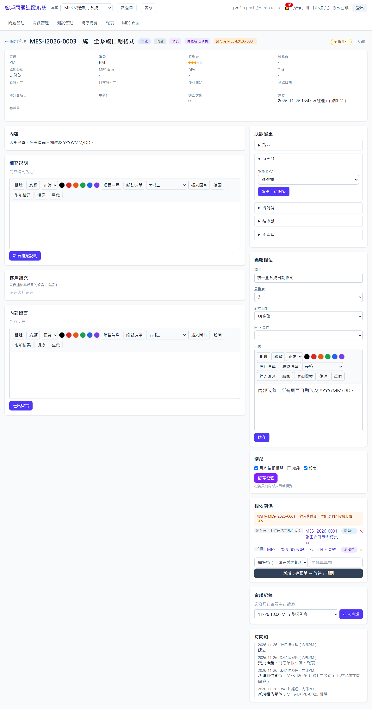

| 區塊 | 說明 |
|---|---|
| 狀態變更 | 展開目標狀態 → 填欄位 → 按「確認：○○」 |
| 編輯欄位 | PM 階段可改標題、內容、嚴重度、處理類型、MES 頁面 |
| 補充說明 | 派工後本文鎖定，變更用這裡追加 |
| 客戶補充 | 連結客戶單的留言（唯讀） |
| 內部留言 | 團隊討論，客戶看不到 |
| 標籤 | 內部分類，見 4.12 |
| 相依關係 | 需等待／相關的其他內部單，見 4.13 |
| 會議紀錄 | 討論過這張單的會議，可「排入會議」 |
| 時間軸 | 完整歷程 |

右上「☆ 關注」見 [7.8](07-common.md)。

### 派工

- **待開發**：選 DEV 負責人。
- **待測試**：不需開發（設定調整等），選 Test 負責人。

送出後內部單標題與內容**鎖定**，連結的客戶單也鎖定。派工前請先改好內容。客戶**正在編輯**連結的客戶單時，派工會被擋下（訊息「客戶正在編輯客戶單…」），請等客戶儲存或編輯鎖逾時後再派工。有未完成的「需等待」上游單時，也不能派給 DEV（見 4.13）。

### 取消／不處理

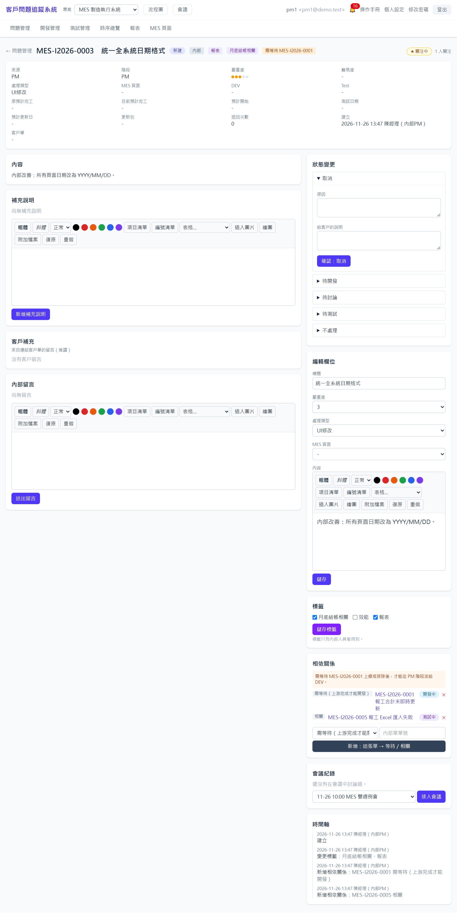

填「原因」；有連結客戶單時另填「給客戶的說明」。若連結的內部單因此全部排除，客戶單回到「需處置」。

### PM結案

在內部單展開「狀態變更 → PM結案」，填寫結案原因。有連結客戶單時，另填「給客戶的說明」，客戶只能看到這段處理說明。送出前可查看需要收尾的人。

新建、待討論及無人需要收尾的單會直接結案。其餘單據先進入「結案收尾中」，所有負責人都確認後才完成。待審延期申請在送出時自動駁回；結案完成後，單據會離開尚未凍結的更新包。收尾期間可按「撤回結案」恢復原狀態。再次送出會新增一輪，先前的確認與作廢紀錄保留。

結案代表已解決。有效連結單全部上線或結案時，客戶單轉為待結案，由客戶確認或提出異常。已完成結案的內部單不能重開。

### 刪除（移到回收筒）

只有**新建**狀態的內部單可以刪除，其它狀態請用「取消」。

| 做法 | 說明 |
|---|---|
| 單張 | 內部單右上「刪除」 |
| 多張 | 問題管理首頁勾選左側的單，按「刪除選取」。不能刪的單（不是新建、不是你建的、已排入更新包）會略過，並列出原因 |

- 可以刪除的人：內部 PM，或這張單的建立者。
- 刪除的單移到專案的[回收筒](08-project-admin.md)，從清單、報表、匯出、相依關係、會議裡都看不到。由專案管理員還原或永久刪除。
- 討論過這張單的會議事項會顯示「原關聯的內部單在回收筒」，連結仍保留，編輯事項也不會清掉；還原後連結自動恢復。在單號欄輸入其它單號才會改掉。
- 連結的客戶單若因此沒有其它進行中的內部單，會回到「需處置」。客戶看不到內部單被刪除的紀錄。
- 打開已刪除單的網址，會顯示它在何時被誰刪除。

## 4.10 延期審核

DEV 申請延期後，在問題管理首頁按「核准」或「駁回」。核准會更新「目前預計完工」；「原預計完工」保留不變。

## 4.11 要求客戶補充資料

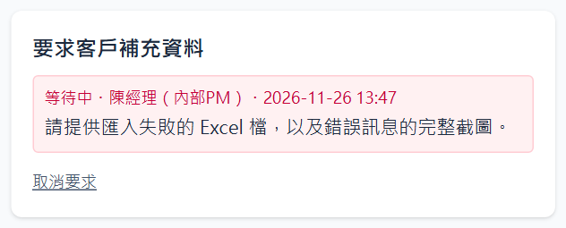

1. 開啟客戶單，右側「要求客戶補充資料」。
2. 寫清楚要什麼（截圖、log、重現步驟…，最多 1000 字），**客戶會看到這段文字**。
3. 按「通知客戶補充」。

| 情況 | 結果 |
|---|---|
| 客戶留言或修訂內容 | 要求自動解除，你收到通知，清單標示「客戶已補充」 |
| 不需要了 | 按「取消要求」 |
| 超過 3 天未回覆 | 系統提醒開單者與你，只提醒一次 |

- 不改變客戶單狀態，也不影響拋單鎖定與自動轉待結案。
- 一張單同時只能有一個等待中的要求；結案或取消的單不能發出。
- 歷次要求收在「過去的要求」。
- 只有客戶帳號的留言／修訂會解除要求；內部人員（含系統管理員）留言不會。

## 4.12 標籤

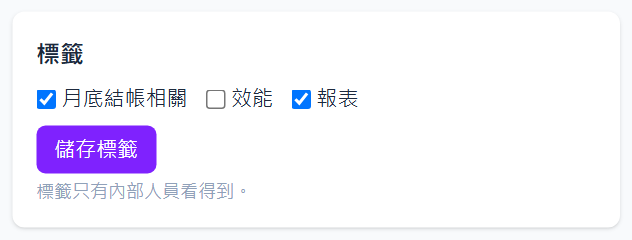

- 內部 PM、DEV、Test 都能在內部單右側勾選標籤 →「儲存標籤」。
- 標籤清單由系統管理員在[選項管理](09-system-admin.md)的「內部單標籤」維護。
- 停用的標籤仍保留在舊單上（標示「已停用」），取消勾選後就不能再勾回。
- 客戶看不到標籤。

## 4.13 相依關係

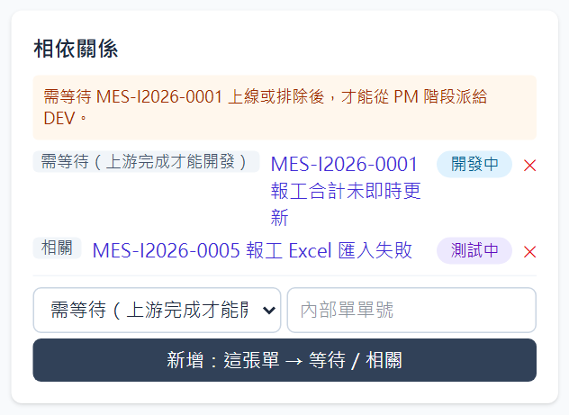

在內部單右側「相依關係」選類型、輸入**同專案**的內部單單號 → 新增。只有內部 PM 能新增與移除。

| 類型 | 效果 |
|---|---|
| 需等待（上游完成才能開發） | 上游尚未上線、結案或排除前，這張單不能從 PM 階段派給 DEV |
| 相關 | 只做標示 |

- 只擋「PM → DEV」派工；直接送測、以及已經在 DEV／Test 的單不受影響。
- 不能相依自己、重複建立或形成循環。
- Test 新發現的單不能設「需等待」。
- 上游單的頁面會列出「等待這張單的」。
