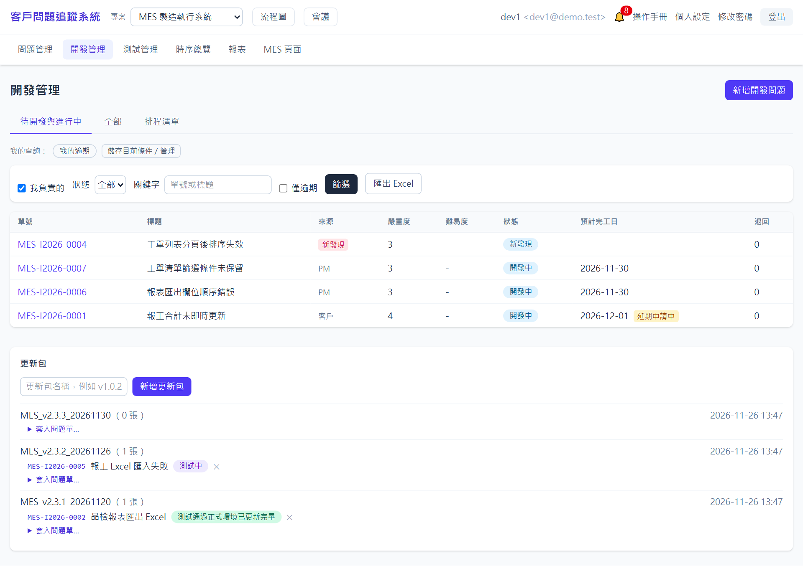
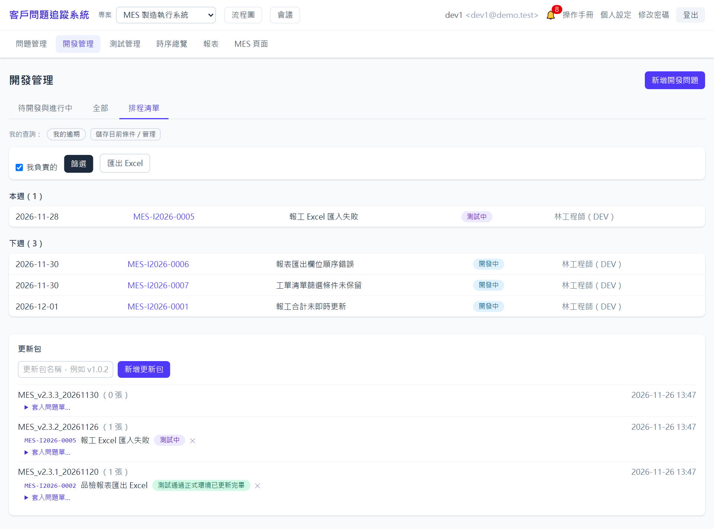
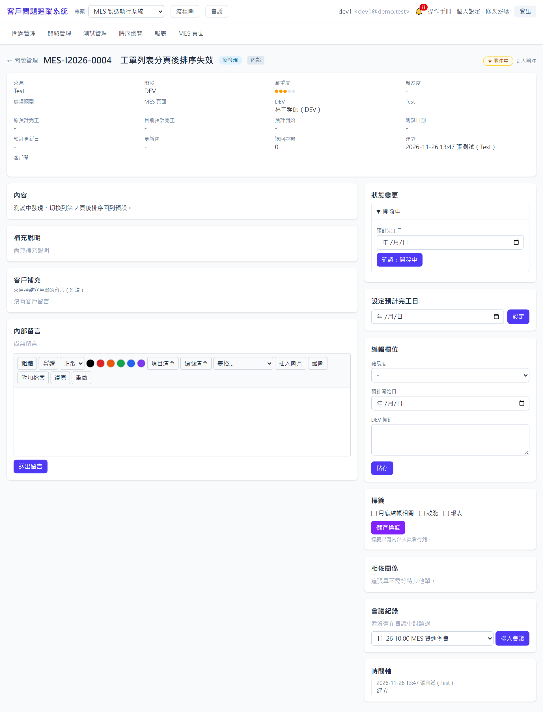
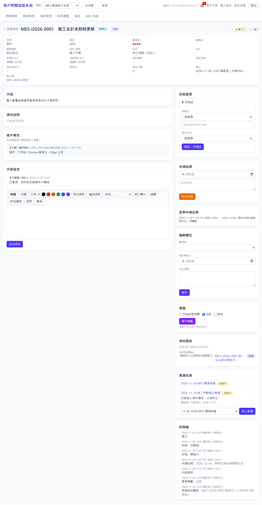
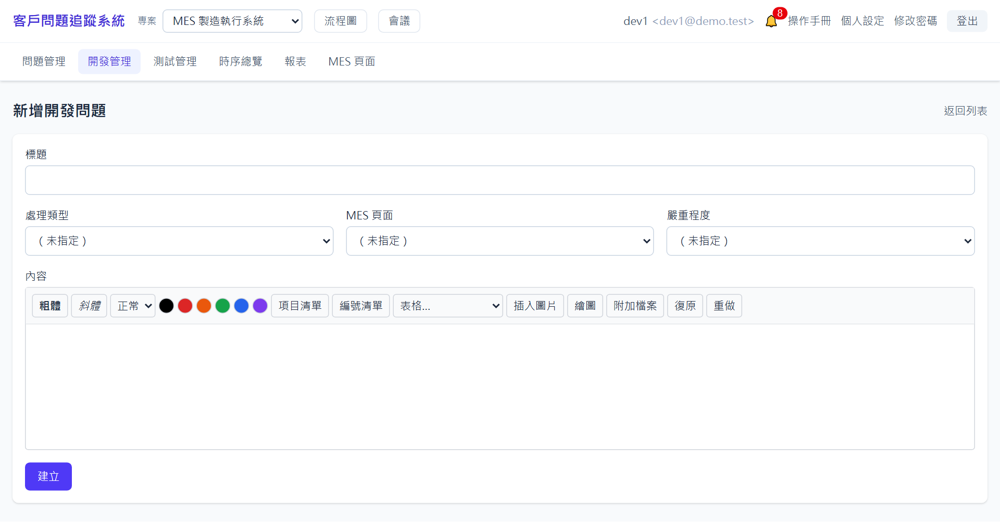
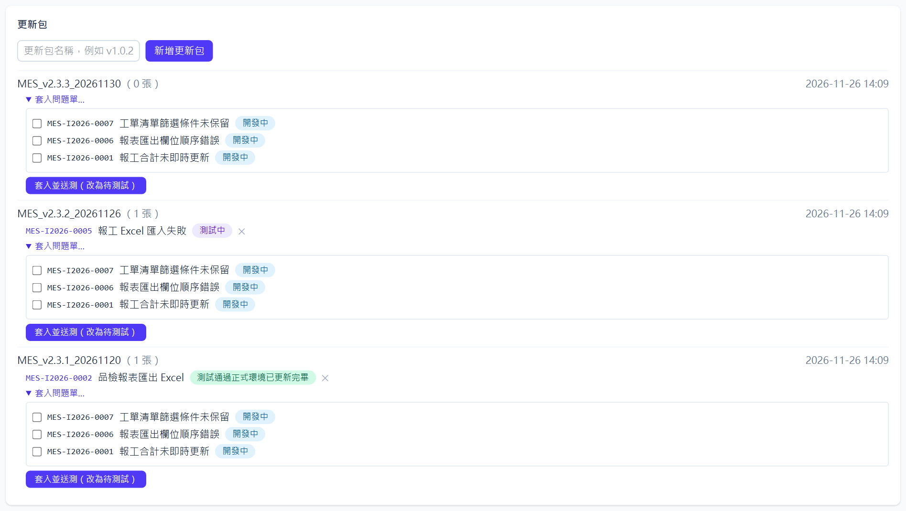
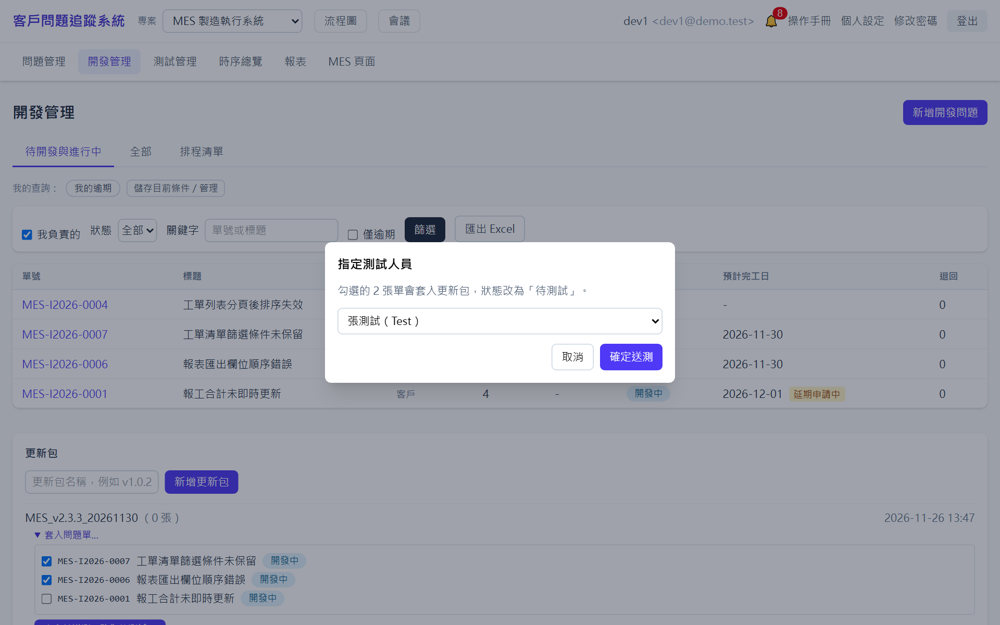

# 5. DEV 開發人員

## 5.1 開發管理清單

| 分頁 | 內容 |
|---|---|
| 待開發與進行中 | 開發階段的單（待開發、新發現、開發中、仍有異常） |
| 全部 | 所有狀態 |
| 排程清單 | 依預計完工日分組 |
| 結案收尾 | 每次送出收尾各列一筆，可查目前進度及歷次撤回、完成的輪次 |

- 前三個分頁中，有開發管理權限時會預設勾選「我負責的」。自己新增的開發單會自動指派給自己。
- 四個分頁的「PM 派工時間」都取 PM 第一次把內部單轉為「待開發」的時間，顯示到台北時間的分鐘。DEV 自建單、PM 直接派測試或缺少派工事件的舊單顯示「—」。退回重做、撤回結案都保留原派工時間。
- 篩選：狀態、關鍵字、僅逾期；常用條件可存成[我的查詢](07-common.md)。
- 清單下方是更新包區塊（見 5.8）。
- 「延期申請中」表示有待審核的申請。

### 結案收尾與待確認人員

「結案收尾」預設列出目前專案所有收尾中的輪次，最早送出的在最上面。用「收尾狀態」切換到已完成、已撤回或全部；輸入單號或標題可縮小範圍。勾選「只看我待確認」可看到自己仍能確認的工作，含具備上線管理權限時可處理的共用上線收尾。

每列顯示該輪的結案方式、送出時間、已完成數／總數，以及尚待確認的角色與人員。例如進度「1／2」、待確認人員「Test 收尾 王小明」，代表僅剩測試端要確認。撤回後再送出會另外列一輪；直接結案的單沒有收尾輪次。

點單號可跳到單據的收尾區。「匯出 Excel」會匯出目前條件下所有頁的輪次，欄位與順序同畫面，單號可連回收尾區。

在工作清單頂端點「待收尾」的單號，查看結案原因。完成開發端的處理後，在對應角色填寫「收尾說明」並按「確認收尾」。有上線管理權限的人也可處理共用的上線收尾；同一人負責兩個角色時，逐筆確認。最後一筆完成時，系統自動結案。

## 5.2 開始開發

1. 開啟單據。
2. 右側「狀態變更」→「開發中」。
3. 尚未設定過**預計完工日**者，需在此填寫 →「確認：開發中」。

也可以先用「設定預計完工日」單獨設定（只有第一次能直接設定）。

## 5.3 開發中

「編輯欄位」可隨時更新：

| 欄位 | 說明 |
|---|---|
| 難易度 | 1–5 |
| 預計開始日 | |
| DEV 備註 | 技術紀錄，客戶看不到 |
| 嚴重度 | 只有自己建立的 DEV 單、且在開發階段可改 |

## 5.4 申請延期

預計完工日設定後要延後：「申請延期」→ 新日期 + 原因 →「送出申請」。PM 核准前原日期仍然有效。結果會通知你，並記在「延期申請紀錄」。

## 5.5 送測（需更新包）

1. 「狀態變更」→「待測試」。
2. 下拉選既有更新包，或在下方輸入新更新包名稱（例：`MES_v2.3.1_20261120`）。
3. 選 **Test 負責人**。單已經有 Test 負責人（例如退回重做、或 Test 開的新發現單）時不會再問，沿用原本的人。
4. 按「確認：待測試」。Test 負責人會收到通知。

單上已套了更新包時，下拉會預先選好。多張單要一起送測，用 5.8 的「套入並送測」。

## 5.6 退回重做

Test 判定「仍有異常」時單據回到開發階段，「退回次數」+1。看完內部留言後，「狀態變更」→「開發中」。

## 5.7 新增開發問題

開發管理 →「新增開發問題」。標題、內容必填；建立後直接是「待開發」，內容立即鎖定，DEV 負責人自動是你。

標題欄會提示相似問題（見 [7.10](07-common.md)）。

## 5.8 更新包

開發管理頁最下方，列出每個更新包與裡面的單。

### 建立

輸入名稱 →「新增更新包」。送測時直接輸入新名稱也會建立。

### 套入並送測

一個更新包可以放多張修正：

1. 在更新包下展開「套入問題單…」，勾選要放入的單（列出專案內所有「開發中」的單，**含別人負責的**）。
2. 按「套入並送測（改為待測試）」。
3. 在對話框指定 Test 負責人 →「確定送測」。

- 勾選的單**全部**已有 Test 負責人時，可選「沿用各單原本的 Test」；選了某位 Test 則勾選的單全部改派給他。
- 整批一起成功或一起失敗：任一張不符合條件，全部不會變更。
- 標示「目前在 ○○」的單會改放到這個更新包。

### 移出

按單據旁的 ✕ → 確認。結果依單據目前狀態而定：

| 目前狀態 | 結果 |
|---|---|
| 開發中 | 只移出更新包，狀態不變 |
| 待測試 | **撤回送測**：退回「開發中」並移出更新包，通知 Test、DEV 負責人與關注者 |
| 排程測試、測試中、之後的狀態 | 不能移出；要重做請測試人員判定「仍有異常」退回 |

- 撤回送測不增加退回次數；Test 負責人保留，再次送測時沿用。
- 狀態變更區沒有「撤回」按鈕，撤回只能從更新包移出。
- 包內第一張單確認已上線時，系統就會鎖定整個更新包的成員。其餘單據仍可逐張確認上線；要加入新的修正，請選用其他尚未上線的更新包。
