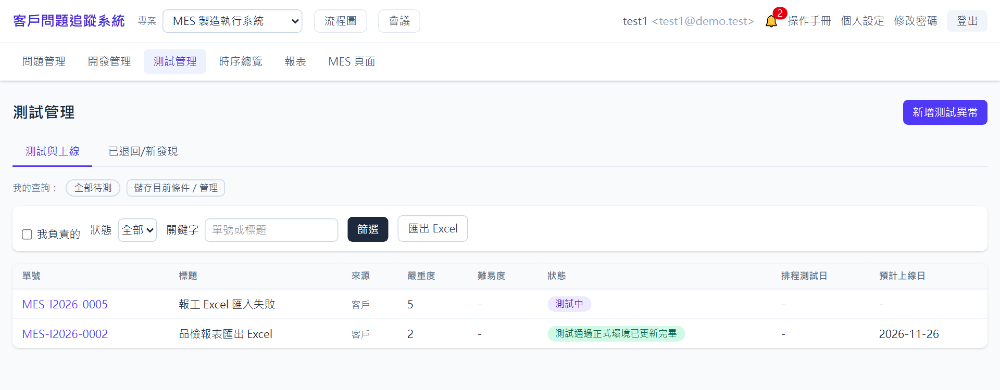
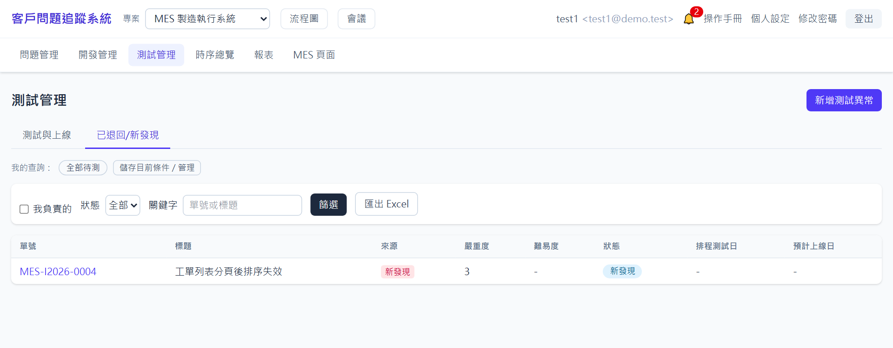
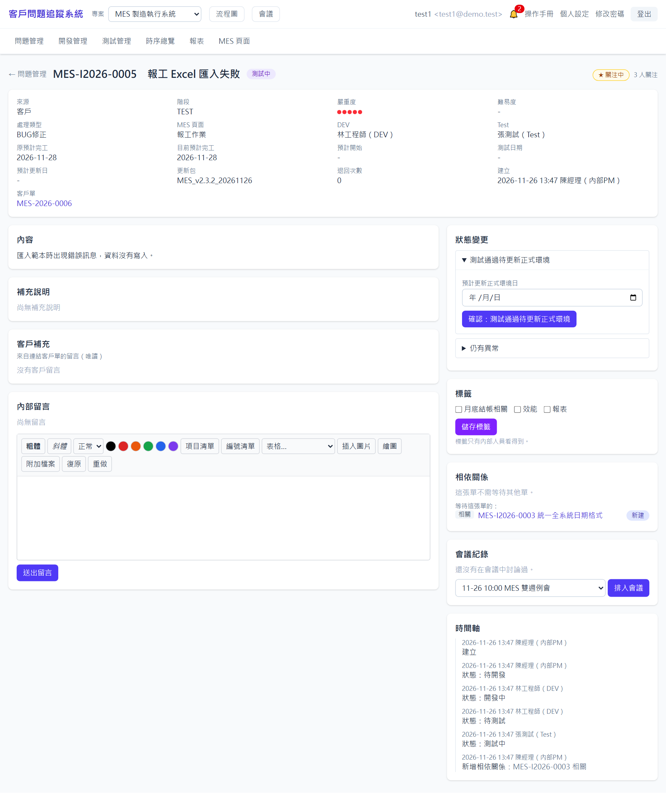
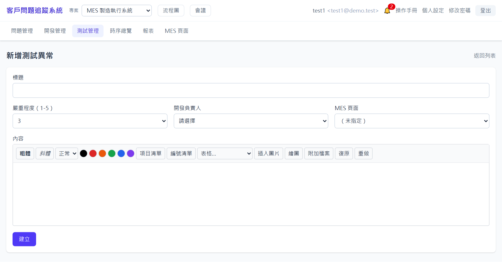

# 6. Test 測試人員

## 6.1 測試管理清單

| 分頁 | 內容 |
|---|---|
| 測試與上線 | 測試與上線階段的單 |
| 已退回/新發現 | 你們退回或新開、目前在 DEV 的單 |
| 結案收尾 | 專案內部單的收尾輪次、進度與待確認人員 |

常用的篩選條件可存成[我的查詢](07-common.md)。

> DEV 送測時必須指定 Test 負責人，被指定的人會收到通知，並出現在「我負責的」。自己開的新發現單，Test 負責人自動是自己。

### 測試派工時間與來源

三個頁籤都顯示「測試派工時間」和「派工來源」。PM 從新建、待討論直接派到待測試時，來源是「PM」；開發單筆送測或透過更新包批次送測時，來源是「開發」。時間以台北時間顯示到分鐘。

「測試與上線」和「已退回/新發現」顯示最近一次送測。例如週一 PM 派測、週二測試退回，退回清單仍顯示週一的 PM 派工；週四開發修正後再送測，清單就顯示週四的開發送測。排程、開始測試、撤回送測或撤回結案都保留原送測紀錄。新發現尚未送測、舊單缺少送測紀錄時，兩欄顯示「—」。

### 結案收尾

預設顯示本專案收尾中的輪次，依送出時間由早到晚排列。可依單號、標題搜尋，或切換到已完成、已撤回、全部。勾選「只看我待確認」會列出自己可以確認的工作，含有上線管理權限時能處理的共用上線收尾。

每輪各列一筆。派工時間與來源取該輪送出結案當時最近一次送測。撤回、重新送測再送出結案，第一輪仍顯示原來的派工。已完成數／總數包含整輪工作；點單號可查看收尾說明及紀錄。直接結案的單沒有收尾輪次。

### 頁首待收尾提醒

在工作清單頂端點「待收尾」的單號，查看結案原因。完成測試端的處理後，在對應角色填寫「收尾說明」並按「確認收尾」。有上線管理權限的人也可處理共用的上線收尾；同一人負責兩個角色時，逐筆確認。最後一筆完成時，系統自動結案。

## 6.2 執行測試

| 目前狀態 | 可選操作 | 必填 |
|---|---|---|
| 待測試 | 排程測試 | 排程測試日 |
| 待測試、排程測試 | 測試中 | |
| 測試中 | 仍有異常（退回 DEV） | |
| 測試中 | 測試通過待更新正式環境 | 預計更新正式環境日 |
| 測試通過待更新正式環境 | 測試通過正式環境已更新完畢 | |

**退回前**請先在「內部留言」寫明重現步驟並附圖（狀態變更本身沒有原因欄位）。

**撤回送測**：單據還在「待測試」時，DEV 可以把它從更新包移出，單會退回「開發中」並通知你。排定測試日或開始測試後，DEV 就不能撤回。

## 6.3 更新正式環境

1. 依「更新包」更新正式環境。
2. 確認完成後，「狀態變更」→「測試通過正式環境已更新完畢」。

> 這一步**無法復原**。當客戶單的所有內部單都完成時，客戶單自動轉「待結案」並通知客戶，請確認真的上線後再按。

## 6.4 新增測試異常

測試中發現新問題：測試管理 →「新增測試異常」。

- 標題、嚴重程度、**開發負責人**、內容必填。
- 狀態為「新發現」，直接進 DEV，同時出現在 PM 清單。
- 嚴重度之後**只有開單的 Test 本人**能改。
- 標題欄會提示相似問題（見 [7.10](07-common.md)），開單前先確認是否已有人回報。
- 新發現的單直接進 DEV，不能設定「需等待」其他單。
