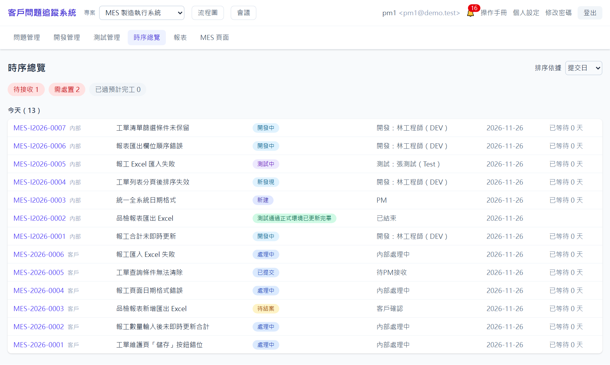
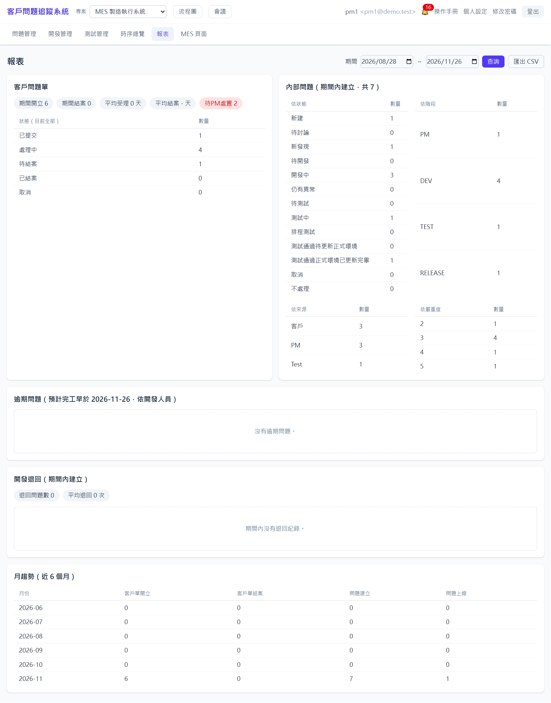
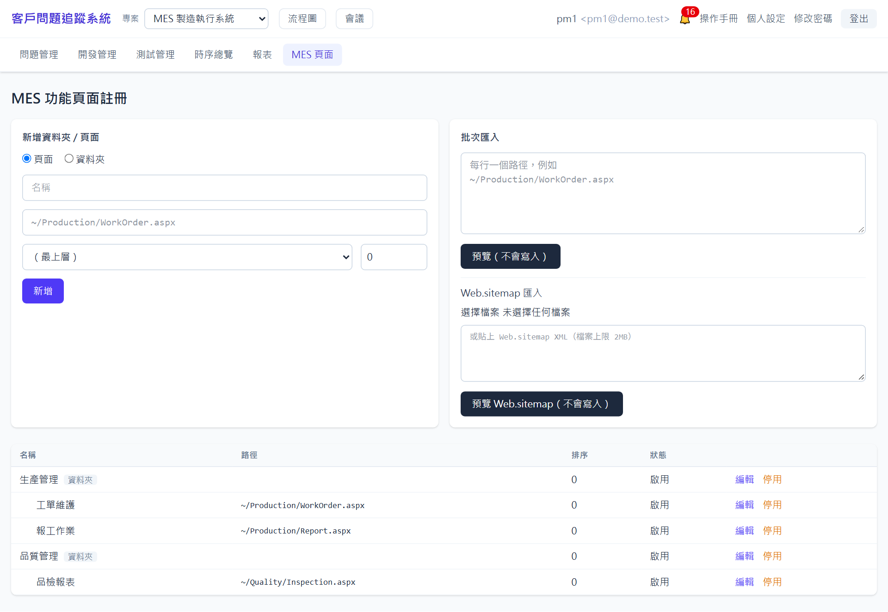
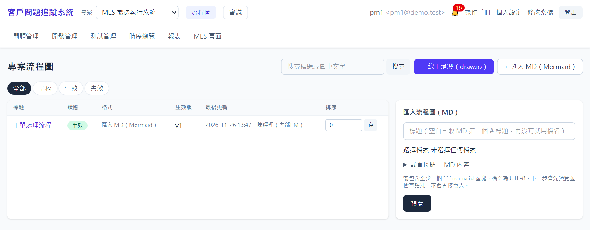
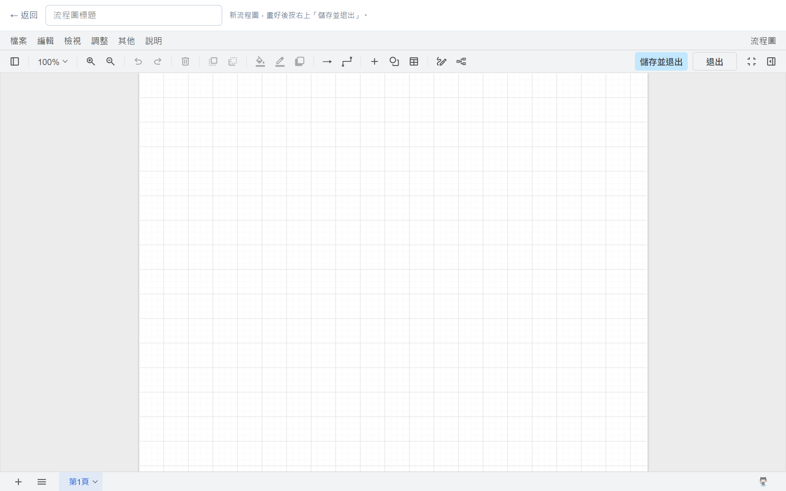
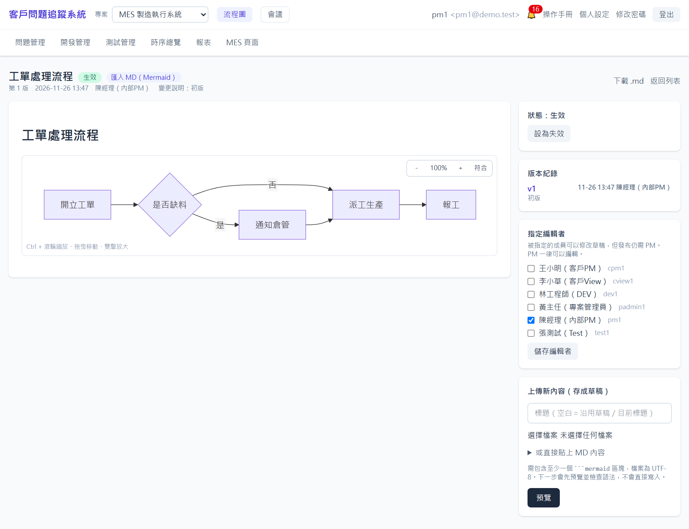
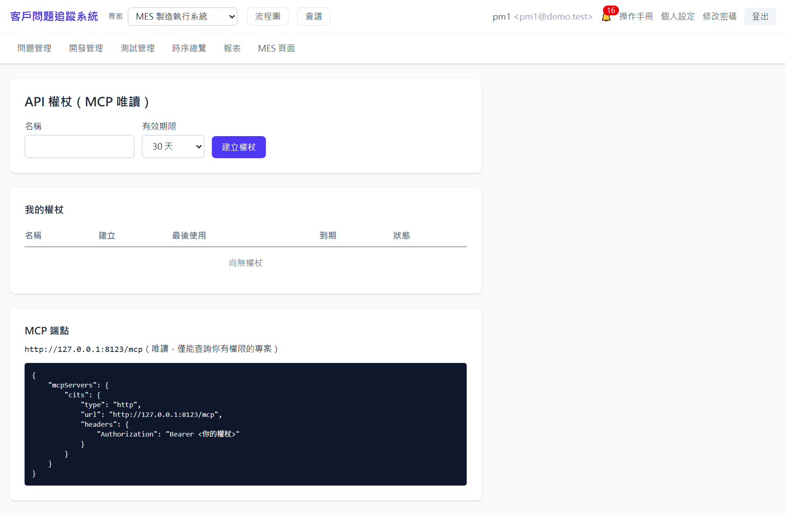
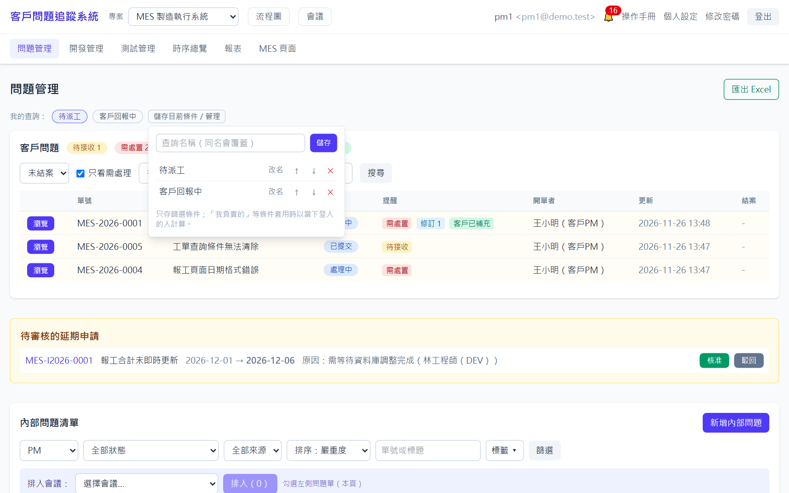

# 7. 共用功能

## 7.1 編輯器

所有內容與留言欄位共用同一個編輯器。

| 功能 | 操作 |
|---|---|
| 文字樣式 | 粗體、斜體、字級、6 種顏色、項目／編號清單 |
| 表格 | 「表格…」插入 3×3；游標在表格內可增刪列欄、切換標題列、合併／分割儲存格 |
| 圖片 | 「插入圖片」、直接貼上截圖，或拖曳到編輯區 |
| 附件 | 「附加檔案」；單檔上限 100 MB，大檔自動分段上傳並顯示進度 |
| 繪圖 | 在截圖上畫框、圓、箭頭 |
| 草稿 | 停止輸入約 3 秒自動儲存；下次開啟出現「有未存檔的草稿」，可還原或捨棄 |

允許的附件類型：`png jpg jpeg gif webp mp4 webm mov txt log zip pdf xlsx csv`

### 繪圖標註

1. 按「繪圖」，勾選要放上畫布的圖片（可多張；也可選「空白畫布」）。
2. 在畫布上標註，預設為紅色框線與紅色箭頭。
3. 儲存後，選取的圖片會合併成一張。
4. **雙擊**該圖可再次編輯。

- 手機版不提供繪圖。
- 原始截圖仍保留為附件，遮蔽敏感資訊**不能**只靠畫框蓋住：請先處理原圖再上傳。

<!-- internal -->
## 7.2 時序總覽（內部）



依日期排列客戶單與內部單，取代 SLA 追蹤。

| 排序依據 | 分組 | 預設角色 |
|---|---|---|
| 提交日 | 今天／昨天／本週／更早 | PM |
| 最後動作 | 同上 | |
| 預計完工 | 已逾期／即將到期／之後 | DEV |
| 排程測試 | 已逾期／即將到期／之後 | Test |
| 預計上線 | 同上 | |

後三種排序只列出尚未結束、且已填該日期的內部單。上方標籤顯示待接收、需處置、已過預計完工的數量。「即將到期」預設為 3 天內。

## 7.3 報表（內部）



- 選期間（預設近 90 天）→「查詢」；「匯出 CSV」可用 Excel 開啟。
- 內容：客戶單開立／結案數與平均受理、結案天數；內部單依狀態、階段、來源、嚴重度；依開發人員的逾期清單；退回排行；近 6 個月趨勢。
<!-- /internal -->

## 7.4 Excel 匯出

各清單頁都有「匯出 Excel」。

- 依**目前篩選條件**匯出，請先按「篩選」再匯出。
- 檔案含清單、明細（兩者可互相跳轉）與匯出條件三種工作表。
<!-- internal -->
- PM 問題管理會一起匯出客戶單及目前選取的內部頁籤。一般內部單匯出「問題出處」與「來源明細」，沿用目前的快篩與排序。「開單時間」「首次派開發」「最近派測試」「派測來源」與畫面一致；「結案收尾」按輪次套用篩選，匯出所有符合的頁面，單號可連回收尾明細。
- 開發管理四個分頁的 Excel 都包含與畫面相同的「PM 派工時間」。「結案收尾」匯出輪次清單與匯出資訊，點清單內的單號即可開啟線上收尾明細。
- 測試管理三個頁籤的 Excel 都包含「測試派工時間」與「派工來源」。收尾清單每輪各列一筆，保留當輪送出時的派工紀錄。匯出涵蓋目前篩選條件下的所有頁，順序與畫面一致。
<!-- /internal -->
- 超過筆數上限（預設 5,000）不會匯出，請縮小範圍。
- 會議可匯出整份清單或單一場次，工作表內容見 [11.8](11-meetings.md)。

<!-- internal -->
## 7.5 MES 頁面（內部）



開單時「功能頁面」下拉的來源，所有內部人員都能維護。

| 操作 | 說明 |
|---|---|
| 新增 | 選資料夾或頁面；頁面路徑須以 `~/` 開頭、`.aspx` 結尾 |
| 編輯／停用 | 停用後新單選不到，舊單仍顯示 |
| 批次匯入 | 每行一個路徑 →「預覽」→「確認匯入」 |
| Web.sitemap 匯入 | 上傳或貼上 XML（上限 2 MB）→ 預覽 → 確認 |

匯入**一定先預覽**，且不會停用或刪除清單中沒有的既有頁面。
<!-- /internal -->

## 7.6 流程圖



| 權限 | 角色 |
|---|---|
| 檢視（生效、失效） | 專案所有成員 |
| 新增、編輯、發布、變更狀態、指定編輯者 | 客戶 PM、內部 PM、專案管理員 |
| 編輯草稿（不能發布） | 被指定的編輯者 |
| 刪除 | 專案管理員 |

可依標題或圖中文字搜尋。一份流程圖的格式建立後固定。

### 方式一：線上繪製（draw.io）



1. 清單右上「＋ 線上繪製」。
2. 輸入標題、畫圖（**僅限一頁**）。
3. 按「儲存並退出」→ 存成草稿。

### 方式二：匯入 MD（Mermaid）

1. 清單下方選 `.md` 檔或貼上內容（需含 ` ```mermaid ` 區塊，UTF-8，上限 200,000 bytes、30 個區塊）。
2. 「預覽」→ 語法檢查通過後「儲存為草稿」。

### 草稿、發布與版本



- **儲存不等於發布**：儲存只更新草稿，一般成員看不到。
- 發布：開啟草稿 → 填「變更說明」（必填）→「發布第 N 版」。
- 草稿儲存紀錄可還原到最近幾次（預設保留 10 次），發布後清除。
- 版本紀錄可看舊版、以舊版為底稿編輯。
- 圖面操作：Ctrl + 滾輪縮放、拖曳移動、雙擊放大。
- 提示「草稿已被其他人更新」：代表同時編輯，重新開啟後再改。

<!-- internal -->
## 7.7 API 權杖與 MCP（內部）



讓 AI 工具以**唯讀**方式查詢專案、客戶單、內部單。入口：個人設定 → API Token。

1. 填名稱、有效期限（30／90／365 天或永不）→「建立權杖」。
2. **權杖只顯示一次**，立刻複製。
3. 依頁面下方範例設定 MCP 用戶端。

建議設期限、不用就撤銷；權杖等同你的查詢權限，不要貼到聊天或版控。客戶帳號不可使用。
<!-- /internal -->

## 7.8 關注

單據右上角的「☆ 關注」：有變更或新留言時通知你；再按一次取消。

| 項目 | 說明 |
|---|---|
| 誰能關注 | 能看到該單的人（含客戶 View） |
| 自動關注 | 客戶單：開單者、接收的 PM |
| 取消後 | 不再因關注收到通知；原本就該通知你的事件照常通知 |
| 人數上限 | 每次通知最多帶 50 位關注者（先關注者優先） |

<!-- internal -->
- 內部單的建立者與 DEV／Test 負責人自動關注。
- 內部單只有內部人員能關注；內部頁面會顯示關注人數（滑鼠停上去看名單）。
<!-- /internal -->

## 7.9 我的查詢

清單上方的「我的查詢」把目前的篩選條件存起來，下次一鍵套用。

<!-- internal -->

<!-- /internal -->

1. 先設好篩選條件並按「篩選」。
2. 展開「儲存目前條件／管理」→ 輸入名稱 →「儲存」。
3. 之後點名稱即可套用。

- 適用：客戶問題清單。
<!-- internal -->
- 內部另有問題管理、開發管理、測試管理三個清單。
<!-- /internal -->
- 只有自己看得到，依專案、清單分開；每個清單最多 20 個。
- 用**相同名稱**儲存會覆蓋舊條件；管理區可改名、調整順序、刪除。
- 只存篩選條件，「只看我開的／我負責的」以套用當下登入的人計算。

## 7.10 重複問題提示

開單時輸入標題（2 個字以上），欄位下方列出最多 5 筆可能重複的單，點開在新分頁查看。提示只供參考，不會擋單。

| 畫面 | 比對範圍 |
|---|---|
| 客戶開單、編輯 | 同專案的客戶單（不含取消） |
<!-- internal -->
| 新增內部問題、建立內部單、新增開發問題、新增測試異常 | 內部單（不含取消／不處理）與客戶單 |
<!-- /internal -->

比對的是**標題用字**，換個說法可能找不到，重要的單請另外用關鍵字搜尋。
