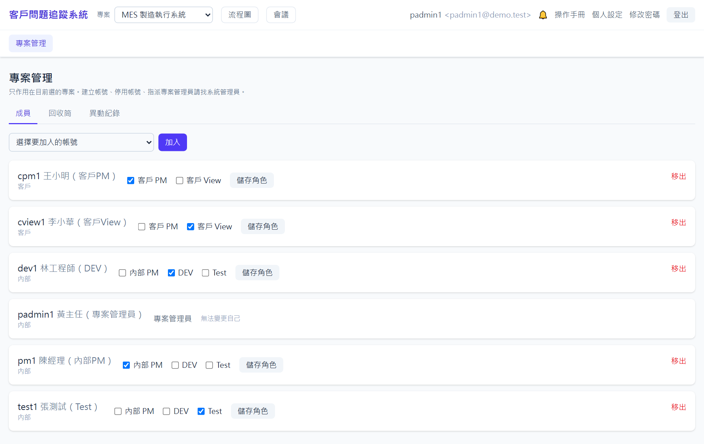
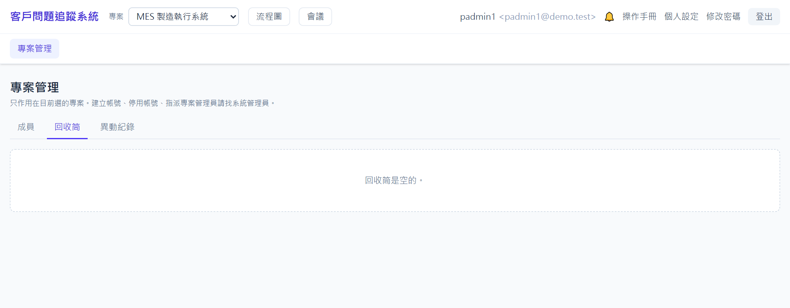
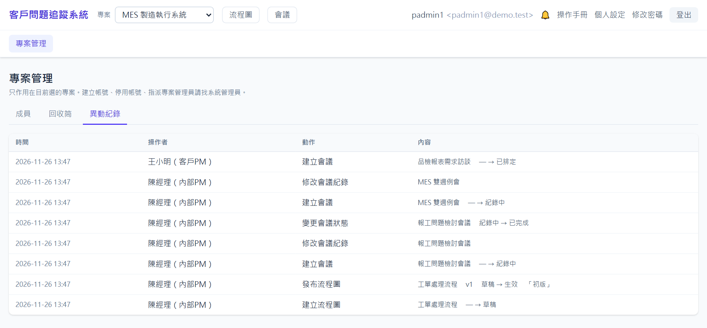

# 8. 專案管理員

管理**單一專案**的成員、回收筒（流程圖、會議、內部單）與異動紀錄。入口：上方選單「專案管理」。

## 8.1 成員

| 操作 | 步驟 |
|---|---|
| 加入 | 下拉選帳號 →「加入」→ 勾角色 →「儲存角色」 |
| 改角色 | 勾選／取消 →「儲存角色」 |
| 移出 | 「移出」→ 確認。角色與流程圖編輯資格一併失去 |

畫面顯示角色名稱，代碼對照：

| 代碼 | 名稱 | 帳號類型 |
|---|---|---|
| client_pm | 客戶 PM | 客戶 |
| client_view | 客戶 View | 客戶 |
| internal_pm | 內部 PM | 內部 |
| dev | DEV | 內部 |
| test | Test | 內部 |
| project_admin | 專案管理員 | 內部 |

限制：

- 只能加入**既有且啟用中**的帳號（開帳號找系統管理員）。
- 不能變更或移除自己。
- 不能授予 `project_admin`，也不能動已具備該角色的成員。
- 一人可有多個角色，權限取聯集。

## 8.2 回收筒

- 「還原」：流程圖回到清單。
- 「永久刪除」：需輸入完整標題確認，**所有版本一併刪除且無法復原**。
- 會議：在[會議頁](11-meetings.md)按「刪除會議」移到回收筒（僅專案管理員）。可還原，或輸入會議主題後永久刪除（討論事項與留言一併刪除）。
- 內部單：內部 PM 或建立者刪除的「新建」內部單（見 [4.9](04-pm.md)）。可還原，或輸入單號後永久刪除。永久刪除會一併刪掉留言、補充說明、附件、標籤、相依關係、客戶單連結與 Excel 匯入紀錄；討論過它的會議事項會保留，討論內容開頭註明「原關聯內部單 ○○ 已永久刪除」。

## 8.3 異動紀錄

成員、角色、流程圖與會議的操作歷程（時間、操作者、內容），以及內部單的刪除、還原、永久刪除。

### 查 Excel 匯入

內部專案管理人員可在「異動紀錄」依時間查詢「由 Excel 匯入」。每次成功確認匯入顯示一筆，包含操作者、來源代碼、新增張數與補充張數。點該列的摘要可展開 Excel 序號、內部單號與處理方式。即使使用同一份 Excel 分次確認，每次也會各留一筆。只有預覽或整批失敗時不會產生這筆紀錄。

功能上線前，已有的單張匯入事件會逐張顯示為「歷史匯入」。歷史補充說明沒有獨立的 Excel 匯入事件，可到原單查閱補充內容。較早的異動可翻頁查詢。
