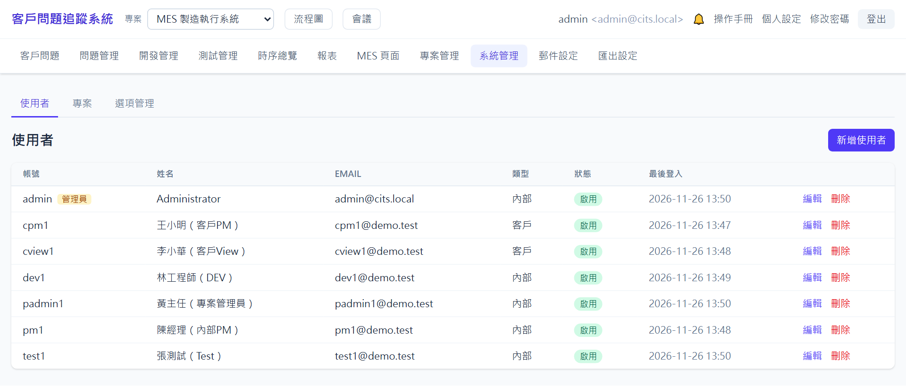
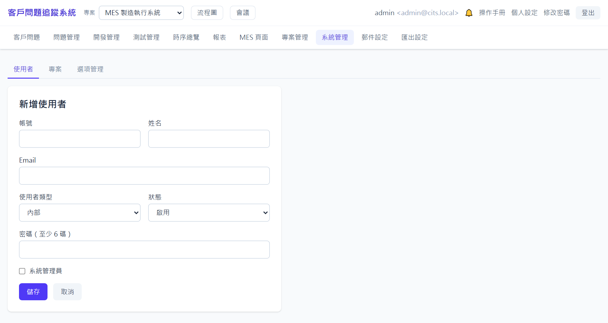
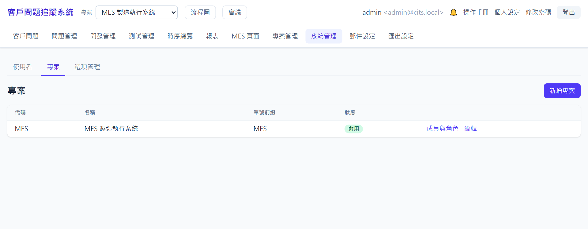
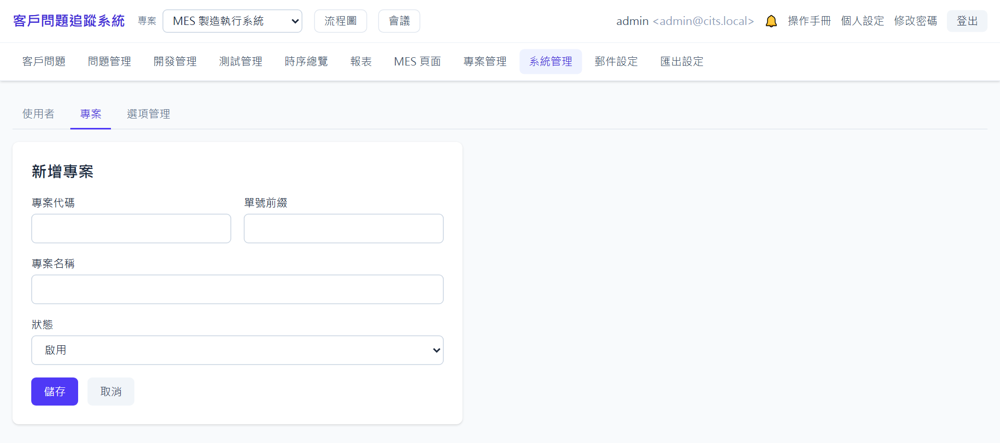
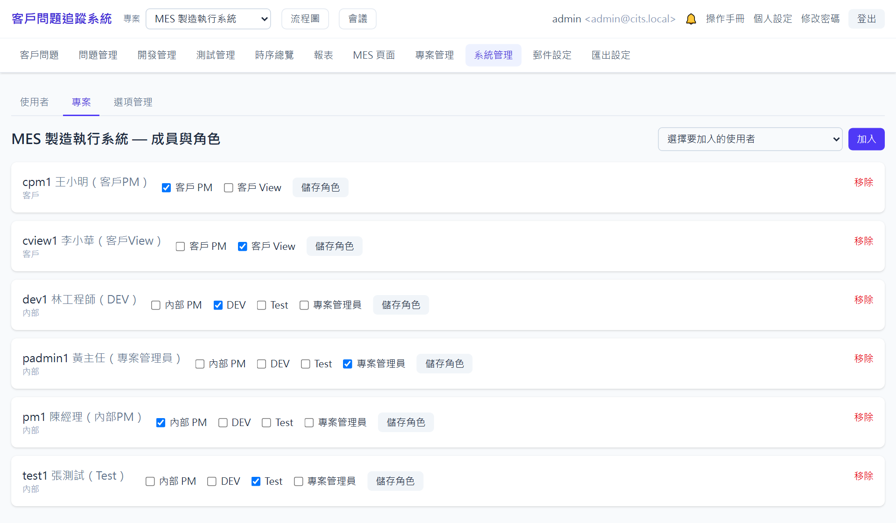
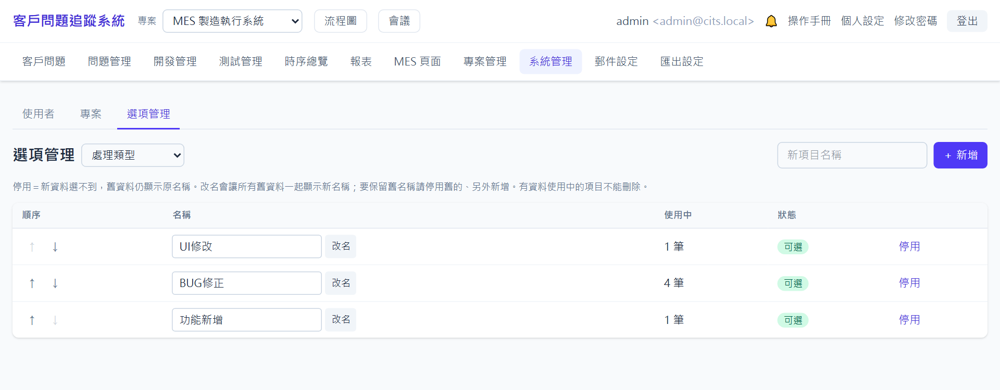
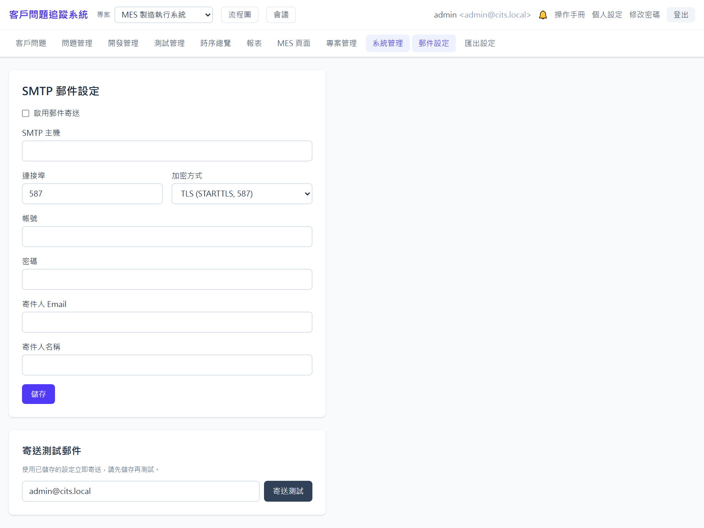
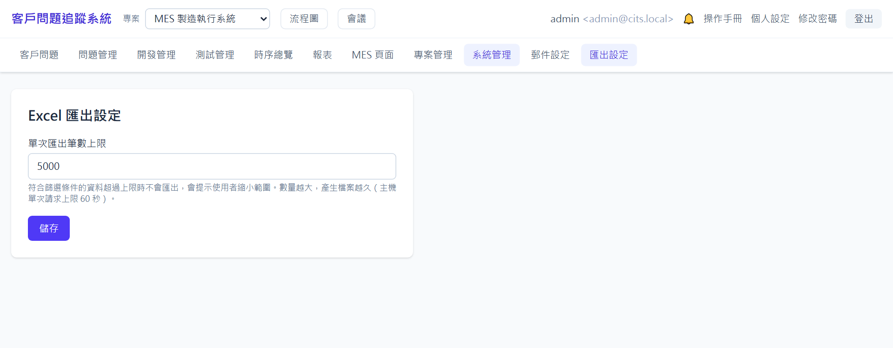

# 9. 系統管理員

系統管理員擁有所有專案的全部權限，客戶端與內部端的功能都能使用（見 9.0）。

## 9.0 管理員可使用的功能

在「使用者」勾選「系統管理員」後，不論使用者類型是客戶或內部，都可以：

| 範圍 | 可以做的事 |
|---|---|
| 專案 | 進入任何專案（不必是成員）；選單顯示全部項目 |
| 客戶問題 | 開立新單、編輯／提出修訂、取消、留言、結案、重開 |
| 客戶單（內部） | 接收客戶單、回覆、PM 處置 |
| 問題管理、開發、測試、時序、報表、MES 頁面 | 全部功能，含修改所有欄位 |
| 會議 | 看所有會議、內部備註與內部留言；編輯、取消、分享給客戶、刪除 |
| 專案管理 | 成員與角色（含只能由系統管理員指派的角色）、資源回收筒、操作紀錄 |
| 系統管理 | 使用者、專案、選項、郵件設定、匯出設定 |

注意事項：

- 管理員開的客戶單，開立者顯示管理員本人，不會代替客戶署名。
- 管理員看客戶單**不會**留下已讀紀錄，客戶看不到管理員讀過。
- 管理員若**不是專案成員**，不會出現在指派開發／測試人員、會議與會者、負責人等選單。要被指派，請把管理員加入該專案成員。

## 9.1 建置新專案

1. 系統管理 → 專案 → 新增專案。
2. 系統管理 → 使用者 → 建立帳號。
3. 專案 →「成員與角色」→ 加入成員、指派角色。
4. MES 頁面建立功能頁面（見 [7.5](07-common.md)）。
5. 郵件設定（選用）。

一個專案至少需要：客戶 PM、內部 PM、DEV、Test 各一人。

## 9.2 使用者

| 欄位 | 說明 |
|---|---|
| 帳號、姓名、Email | 必填 |
| 使用者類型 | 客戶／內部，決定可指派的角色 |
| 狀態 | 停用後無法登入 |
| 密碼 | 至少 6 碼；編輯時留空表示不變更 |
| 系統管理員 | 擁有全部權限，僅給必要人員 |

- 有操作紀錄的帳號**無法刪除**，請改為停用。
- 不能刪除自己、停用自己或移除自己的管理員權限。
- 人員離職：停用帳號即可，其 API 權杖同時失效。

## 9.3 專案

| 欄位 | 說明 |
|---|---|
| 專案代碼 | 唯一識別 |
| 單號前綴 | 用於單號，建立後不建議修改（新舊單號會不一致） |
| 狀態 | 停用後一般成員無法選用 |

## 9.4 成員與角色

加入使用者 → 勾角色 →「儲存角色」。可指派包含 `project_admin` 在內的所有角色。角色代碼對照見 [8.1](08-project-admin.md)。

## 9.5 選項管理

目前可維護「處理類型」「會議類型」「內部單標籤」：

| 操作 | 影響 |
|---|---|
| 新增 | 立即可選 |
| 改名 | **所有舊資料一起顯示新名稱** |
| 停用 | 新資料選不到，舊資料仍顯示原名稱；至少保留一項可選 |
| 刪除 | 僅限沒有任何資料使用 |
| ↑↓ | 調整下拉順序 |

要保留舊名稱語意：停用舊項目，另外新增。

「內部單標籤」沒有任何項目時，內部單頁面無法勾選標籤，啟用協作功能後請先建立。

## 9.6 郵件設定

1. 填 SMTP 主機、連接埠、加密方式（TLS 587／SSL 465）、帳密、寄件人。
2. 勾「啟用郵件寄送」→「儲存」。
3. 「寄送測試郵件」（用**已儲存**的設定）。

- 密碼加密保存、不回顯；留空表示不變更。
- 停用期間的通知只留在站內，之後啟用**不會補寄**。
- 停用時「忘記密碼」功能不可用。
- 郵件由排程每分鐘寄送，需主機 cron 運作。

## 9.7 匯出設定

設定單次 Excel 匯出筆數上限（預設 5,000）。調太大可能超過主機 60 秒請求限制。

## 9.8 背景設定與排程

下列系統設定**沒有設定畫面**，預設值如下，要調整請洽維運人員：

| 設定 | 預設 | 作用 |
|---|---|---|
| needinfo.remind_days | 3 | 補充資料要求超過幾天提醒一次 |
| similar.min_score | 0.34 | 重複問題提示的相似度門檻（越高越嚴格） |
| watch.max_recipients | 50 | 單次通知最多帶幾位關注者 |
| saved_query.max_per_list | 20 | 每人每個清單可存的查詢數 |

補充資料提醒每天台北時間 09:30 執行，與郵件寄送一樣依賴主機 cron。

權限：要求客戶補充資料＝內部 PM；內部單標籤＝內部 PM、DEV、Test；相依關係＝內部 PM。
