# 11. 會議

記錄專案會議：議程、討論內容、結論、負責人與期限。入口：左上角「會議」（跟著目前專案）。

## 11.1 誰能做什麼

| 動作 | 可以的人 |
|---|---|
| 檢視、下載行事曆 | 專案成員（客戶只看得到開放給客戶的會議） |
| 新增會議、安排下次會議 | 客戶 PM、內部 PM、DEV、Test |
| 留言、回覆 | 客戶 PM、內部 PM、DEV、Test |
| 編輯（資料、討論事項、紀錄、狀態） | 內部 PM：全部會議。其他人：自己發起或列在與會者的會議（客戶 PM 限客戶發起的會議） |
| 取消、恢復排定 | 發起人、內部 PM |
| 匯出 Excel | 客戶 PM、客戶 View、內部 PM、DEV、Test |
<!-- internal -->
| 開放給客戶／取消開放 | 內部 PM；或身為發起人、與會者的 DEV、Test |
| 刪除（移到回收筒） | 專案管理員 |
<!-- /internal -->

客戶 View 只能檢視與匯出。

在會議詳情的「Markdown 文件」選取一或多份 UTF-8 的 .md 檔，再按「上傳文件」。上傳後可直接點檔名預覽、切換閱讀或下載原檔。文件獨立儲存；先前附在紀錄中的文件也會依原權限列出。
<!-- internal -->
內部人員上傳預設為「僅內部」。若要提供客戶閱讀，請選「依會議分享設定」。內部建立的會議須開放給客戶並發布紀錄，客戶才能閱讀共享文件。
<!-- /internal -->

## 11.2 會議清單

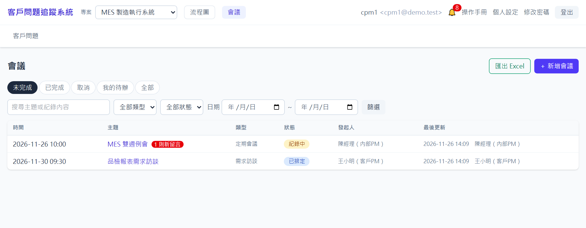

<!-- internal -->
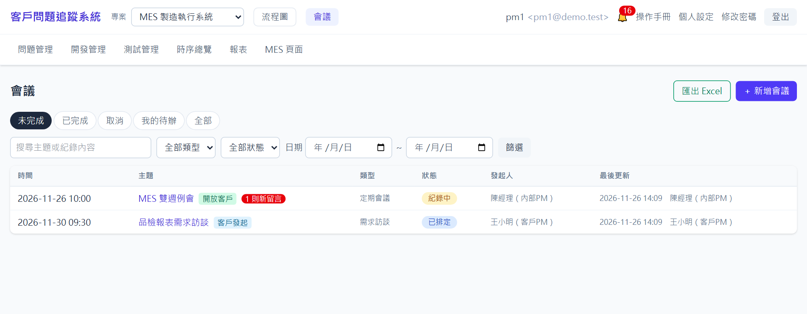
<!-- /internal -->

| 分頁 | 內容 |
|---|---|
| 未完成 | 已排定、紀錄中（依時間由早到晚） |
| 已完成 | 已按「完成紀錄」的會議 |
| 取消 | 已取消的會議 |
| 我的待辦 | 指定我負責、且仍「追蹤中」的討論事項 |
| 全部 | 所有看得到的會議 |

- 主題旁的紅色「N 則新留言」＝你上次開啟後的新留言。
<!-- internal -->
- 內部人員的搜尋範圍包含主題、問題點、討論內容、結論與補充紀錄；清單會標示「客戶發起」或「開放客戶」。
<!-- /internal -->
- 客戶帳號的搜尋只比對會議主題。
- 篩選：關鍵字、類型、狀態、日期起訖（依會議開始日，台北時間）→「篩選」。切換分頁會保留條件，按「清除條件」重設。
- 起訖日期填反時自動對調。
- 狀態篩選和分頁同時生效，例如在「已完成」分頁選「已排定」不會有結果。
- 「我的待辦」分頁沒有篩選與匯出。
- 畫面清單最多顯示 300 場，更早的請用日期篩選。

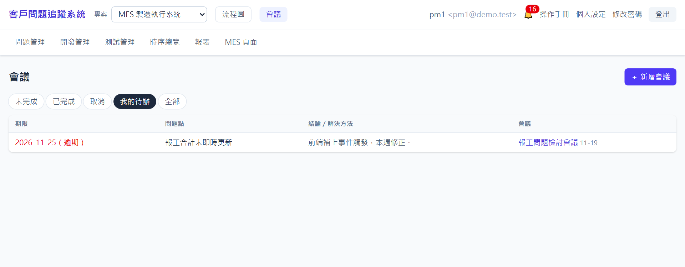

超過期限的事項以紅字標示「逾期」。點會議名稱直接跳到該事項。

## 11.3 新增會議

清單右上「＋ 新增會議」。

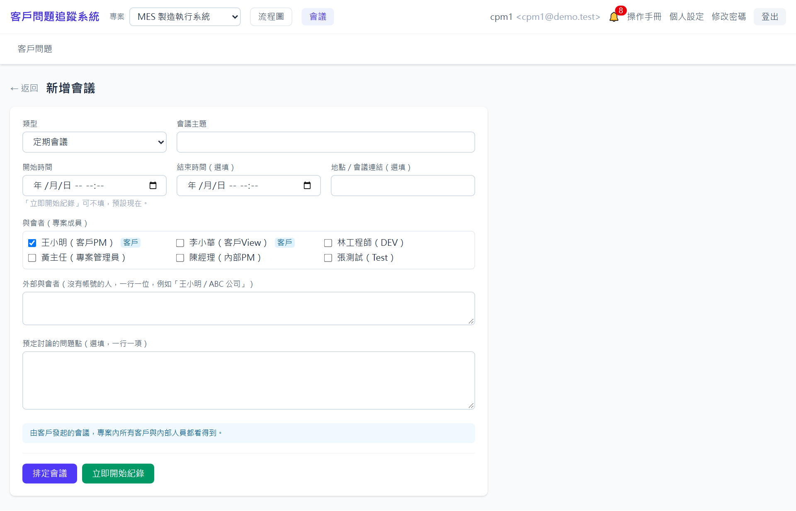

<!-- internal -->
內部人員的畫面多一個「開放給客戶」勾選：

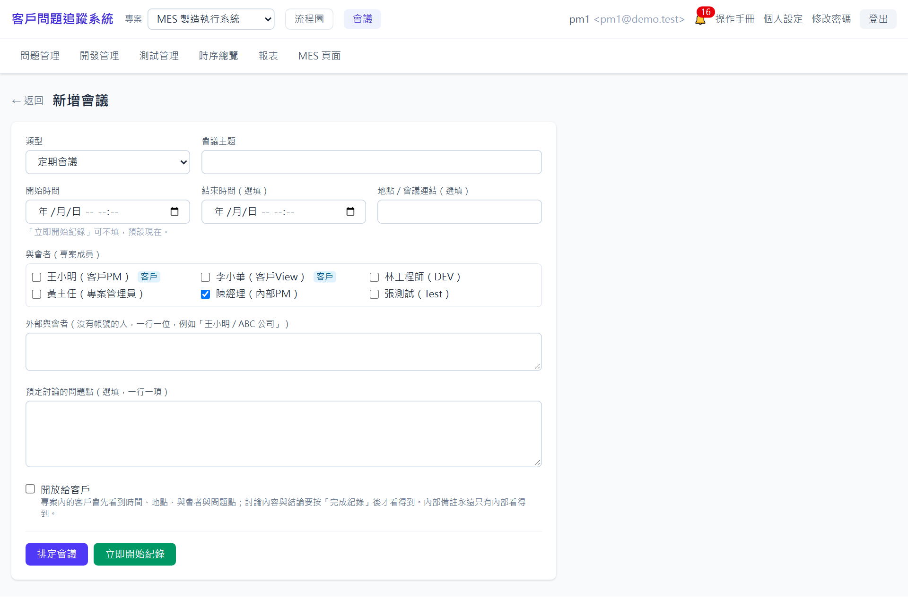
<!-- /internal -->

| 欄位 | 說明 |
|---|---|
| 類型 | 定期會議、問題檢討、需求訪談、其他（實際選項以系統設定為準） |
| 會議主題 | 必填，最多 200 字 |
| 開始時間 | 排定會議必填 |
| 結束時間 | 選填，不能早於開始時間 |
| 地點／會議連結 | 選填 |
| 與會者 | 勾選專案成員；發起人一定會列入 |
| 外部與會者 | 沒有帳號的人，一行一位，最多 30 位 |
| 預定討論的問題點 | 選填，一行一項，建立後成為討論事項 |

送出方式：

- **排定會議**：狀態「已排定」。
- **立即開始紀錄**：狀態「紀錄中」，開始時間沒填就用現在。

客戶發起的會議，專案內所有客戶與內部人員都看得到，內容不會暫緩顯示。

## 11.4 會議紀錄

<!-- internal -->
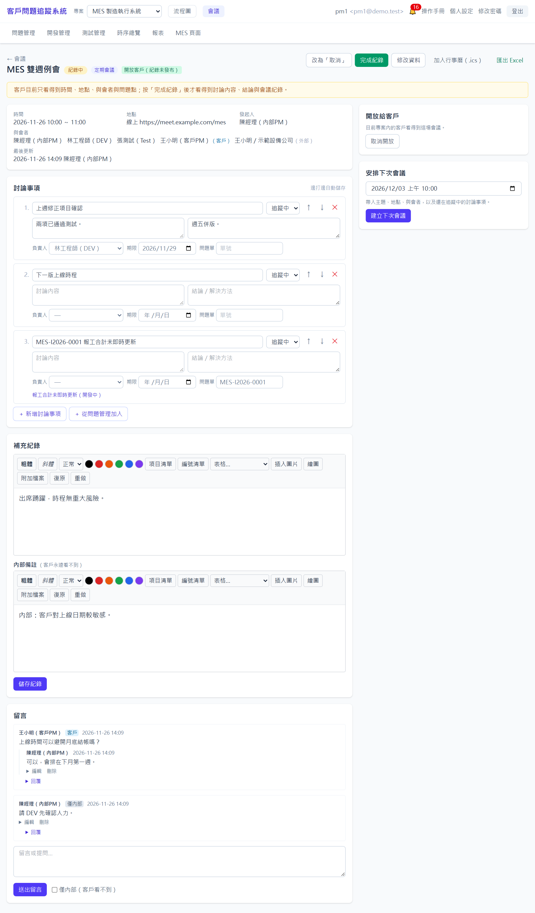
<!-- /internal -->

### 狀態

| 目前狀態 | 按鈕 | 變成 |
|---|---|---|
| 已排定 | 改為「紀錄中」 | 紀錄中 |
| 已排定、紀錄中 | 完成紀錄 | 已完成 |
| 已排定、紀錄中 | 改為「取消」 | 取消（唯讀） |
| 取消 | 改為「已排定」 | 已排定 |

「已完成」的會議仍可編輯，但狀態不能再改回去。

### 討論事項（自動儲存）

| 操作 | 方式 |
|---|---|
| 新增 | 「＋ 新增討論事項」，或在問題點欄按 Enter |
| 填寫 | 問題點、討論內容、結論／解決方法、負責人、期限、狀態（追蹤中／已完成） |
| 排序 | ↑ ↓ |
| 刪除 | ✕ → 確認 |

- 停止輸入約 1 秒或離開欄位就自動儲存，列的右下角顯示「已儲存」。出現紅字代表**沒有存入**。
- 新的一列要先填「問題點」才會建立。
- 負責人必須是專案成員。
- 畫面不會即時同步別人的修改。多人改同一欄位，後存的蓋掉前面。

### 事項附圖與標記

| 操作 | 方式 |
|---|---|
| 貼上截圖 | 先截圖（或在相簿／網頁複製圖片），再按事項裡的「📋 貼上截圖」。電腦也可以在事項的任一個文字框直接 Ctrl+V，或把圖片拖到事項上 |
| 選檔 | 「或選擇圖片檔」（可複選） |
| 放大 | 點縮圖；按 Esc 或點畫面關閉 |
| 標記 | 縮圖下的「✏️ 標記」：開啟繪圖畫面，圖片鎖定為底圖，可畫框、箭頭、文字，按「儲存並退出」後取代原圖（位置不變）。標記過的圖再按「標記」可以繼續修改 |
| 貼上後直接標記 | 勾選「討論事項」標題旁的「貼上後直接標記」，貼上一張截圖就直接開啟標記。這個選擇記在這台電腦的瀏覽器 |
| 移除 | 縮圖下的「移除」→ 確認 |

- 新的一列要先填「問題點」才能加圖。
- 第一次按「貼上截圖」，瀏覽器可能詢問是否允許讀取剪貼簿，請按允許。不允許或瀏覽器不支援時，會跳出一個框，在框裡按 Ctrl+V（手機：長按 → 貼上）。
- 手機截圖後，可以在通知列或相簿把截圖「複製」，再回來按「貼上截圖」。
- 每個事項最多 10 張（系統設定）；單張大小上限同一般附件。
- 圖片和討論內容一樣：開放給客戶的內部會議，完成紀錄後客戶才看得到。
- 「安排下次會議」帶過去的事項會一起帶圖；刪除事項時圖片一併刪除。

<!-- internal -->
### 連結問題單（內部）

三種方式：

1. 在事項的「問題單」欄輸入單號後離開欄位（或按 Enter）。
2. 「＋ 從問題管理加入」：可用單號／標題、階段篩選，預設只看未結案，可跨搜尋複選；已在本會議的單會反灰。一次最多顯示 100 筆。

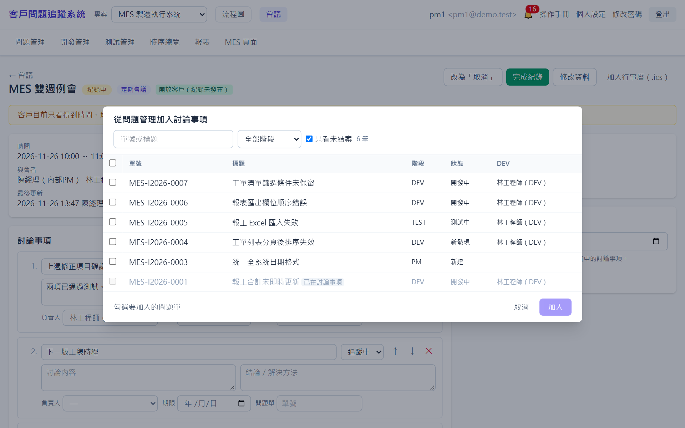

3. 從問題管理清單批次排入：勾選本頁問題單 → 選一場未完成的會議（或「＋ 新會議…」）→「排入」。

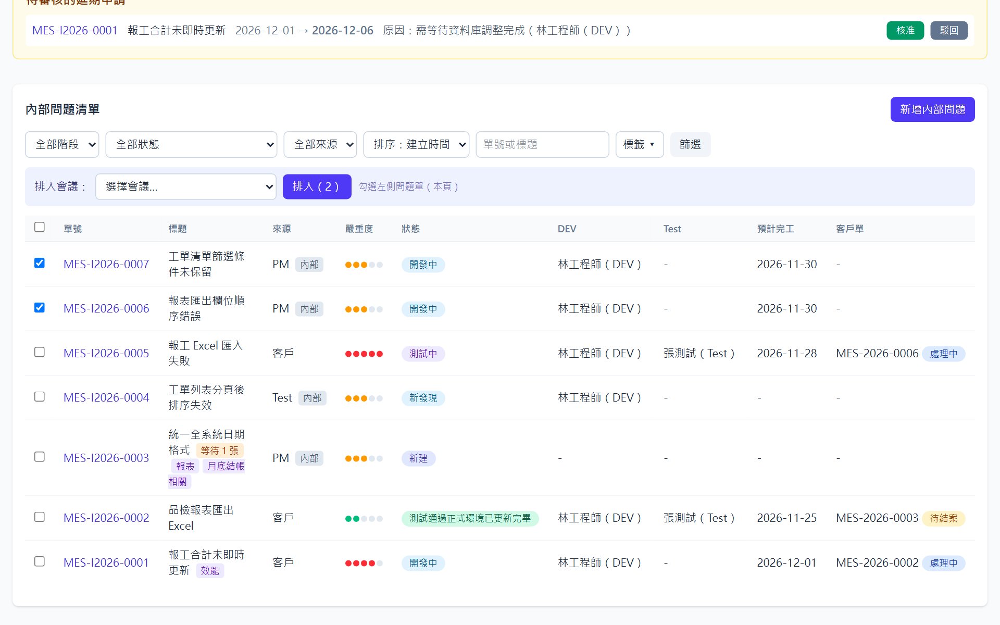

單張內部單頁面右側的「會議紀錄」區塊，會列出這張單在哪些會議被討論過與結論，也能直接「排入會議」。同一串延續下來的事項（安排下次會議帶過去的）合併成一組，標題顯示「N 場：起 → 迄」與最新結論，展開可看每一場的討論內容、結論、負責人。

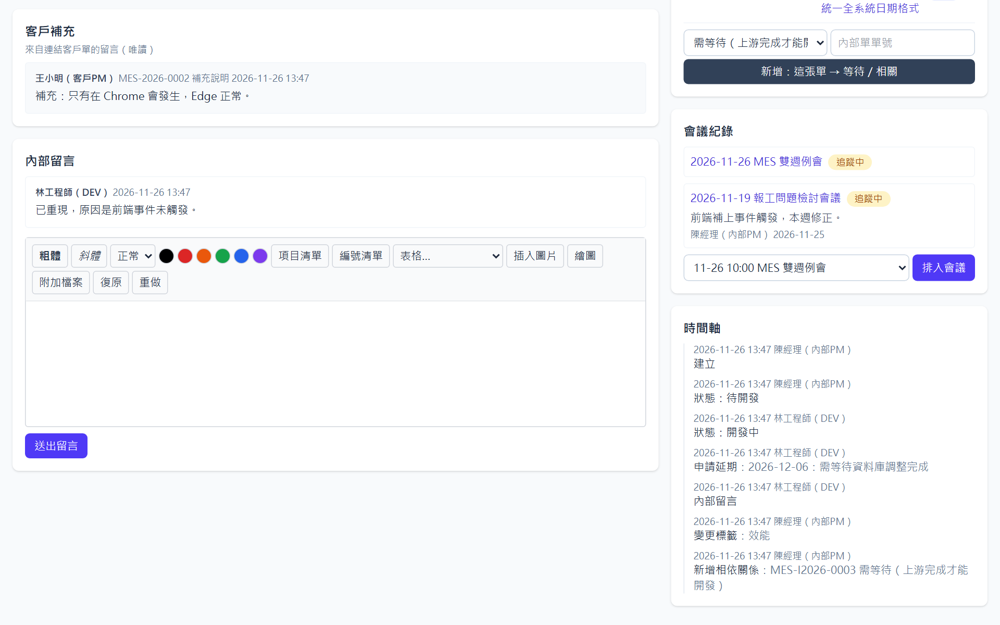

- 同一場會議裡，一張內部單只能連一個事項；其他會議可以再討論同一張單。
- 事項連結的單已結案時，事項旁顯示紅色「內部單已結案」。
- 事項下方的「歷次討論（N）」列出這張單在**其他會議**的討論內容、結論與附圖。
- 會議第一次「完成紀錄」時，有結論的事項會寫進該內部單的時間軸（「會議結論」），並通知關注這張單的人。之後再改結論不會重複通知。

### 轉內部單（內部）

事項還沒連結內部單時，事項列有「轉內部單」：

1. 開啟建單畫面，自動帶入：標題＝問題點；內容＝來源會議與項次、討論內容、結論、事項附圖（另存一份給內部單）。
2. 選來源（依你的角色：內部 PM 可建 PM 單，DEV、Test 建各自的單）、處理類型、MES 頁面、嚴重度，可再修改內容。
3. 按「建立內部單」：建立內部單，同時把這個事項連到新單；事項負責人（內部人員）自動關注這張單。

- 已經有單的議題，直接在「問題單」欄填單號即可，不必另建。
- 內部單時間軸會記「由會議事項建立」與來源會議、項次。

客戶看不到問題單連結。從問題管理加入的事項，**問題點文字包含內部單號與內部標題**，開放給客戶的會議客戶看得到，需要時請改寫。
<!-- /internal -->

### 補充紀錄

自由格式的編輯器（圖片、附件、表格、繪圖）。**要按「儲存紀錄」才會存入**；自動草稿不算存檔。

如果出現「會議紀錄已被其他人更新」，你的修改沒有存入：重新整理後再改，可還原草稿。

<!-- internal -->
下方的「內部備註」（含附件）客戶永遠看不到。
<!-- /internal -->

## 11.5 客戶看得到什麼

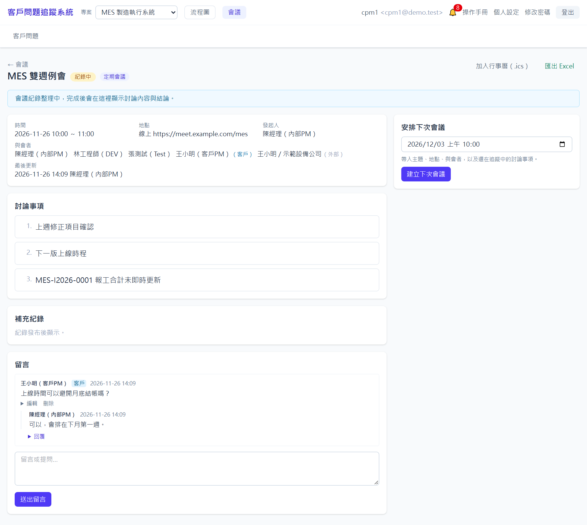

| 內部發起且開放的會議 | 完成紀錄前 | 完成紀錄後 |
|---|---|---|
| 時間、地點、與會者、問題點 | 看得到 | 看得到 |
| 討論內容、結論、負責人、期限、事項狀態、事項附圖 | 看不到 | 看得到 |
| 補充紀錄與附件 | 看不到 | 看得到 |
| 公開留言 | 看得到 | 看得到 |

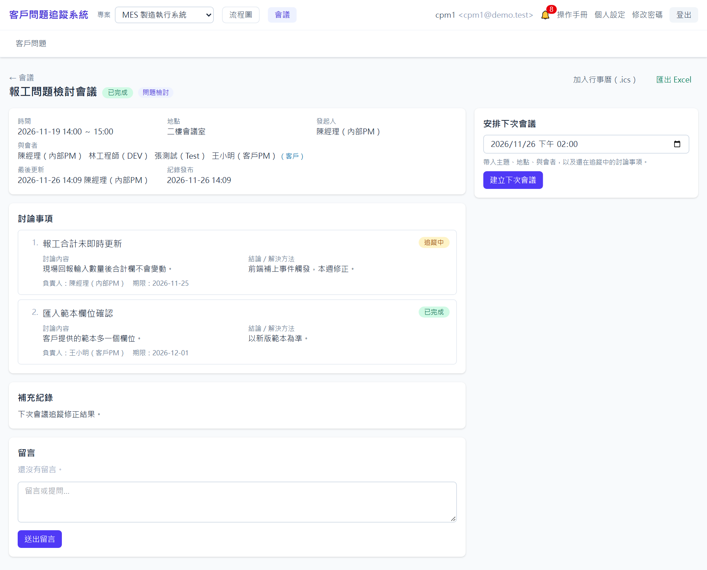

客戶發起的會議一開始就看得到全部內容。

<!-- internal -->
### 開放給客戶（內部）

- 新增時勾選，或在會議頁右側按「開放給客戶」。未開放的會議客戶完全看不到。
- 標籤「開放客戶（紀錄未發布）」＝客戶目前只看得到表頭與問題點。
- 第一次按「完成紀錄」就發布。**發布後再修改，客戶立刻看到**。
- 先完成紀錄、之後才開放的會議，客戶一開放就看得到完整內容。
- 「取消開放」後客戶看不到整場會議（含他們自己的留言）。
- 內部備註、僅內部留言、問題單連結永遠不給客戶。
<!-- /internal -->

## 11.6 留言

- 純文字，最多 2,000 字，回覆只有一層。
- 只能編輯、刪除自己的留言；刪除後顯示「此留言已刪除」。專案管理員仍看得到原內容。
- 取消的會議仍可留言。
<!-- internal -->
- 開放給客戶的會議可勾「僅內部」；內部討論串的回覆一律僅內部。**沒勾就是客戶看得到**。
<!-- /internal -->

## 11.7 下次會議與行事曆

**安排下次會議**（會議頁右側）：選時間 →「建立下次會議」。

- 帶入類型、主題、地點、與會者，以及仍「追蹤中」的討論事項（含附圖）。
<!-- internal -->
- 預設勾選「略過內部單已結案的事項」：連結的內部單已結案的事項不帶過去。
<!-- /internal -->
- 帶過去的事項不含舊的討論內容與結論；舊紀錄留在原會議。
- 新會議的發起人是按按鈕的人。客戶建立的下次會議視為客戶發起。

**加入行事曆**：右上「加入行事曆（.ics）」下載後用 Outlook、Google 行事曆等開啟。沒填結束時間以 1 小時計。系統**不會寄送會議邀請信**；改時間後要重新下載。

## 11.8 匯出 Excel

| 位置 | 匯出內容 |
|---|---|
| 會議清單「匯出 Excel」 | 目前分頁、關鍵字與篩選條件的全部會議 |
| 單一會議頁「匯出 Excel」 | 這一場會議 |

| 工作表 | 內容 |
|---|---|
| 會議 | 一場一列：時間、主題、類型、狀態、地點、與會者、發起人、事項數等 |
| 會議詳細 | 每場的會議紀錄、討論事項與留言 |
| 討論事項 | 一項一列：問題點、討論、結論、負責人、期限、狀態 |

- 匯出內容和畫面看得到的一致：客戶只拿得到開放給客戶的會議；紀錄尚未發布時，不含會議紀錄與討論、結論。
<!-- internal -->
- 內部人員的檔案另含內部備註、內部留言、連結的內部單與「分享給客戶」欄；**轉寄給客戶前請注意**，需要給客戶的版本請用客戶帳號匯出。
<!-- /internal -->
- 超過匯出筆數上限不會匯出，見 [7.4](07-common.md)。
